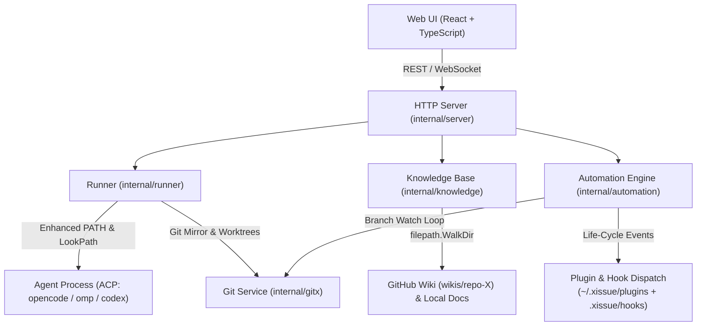

# xIssue 项目交接文档 (Handoff Document)

> 本文档用于记录 xIssue 在 `v0.2.10` 到 `v0.5.0` 期间的核心功能演进、架构改造、故障排查与后续开发规划，供后续开发、排障与持续迭代参考。

---

## 1. 项目概况与当前状态

- **项目名称**: xIssue (Personal AI Agent Issue & Multi-Repo Orchestrator)
- **最新发布版本**: `v0.5.0`
- **代码仓库**: `https://github.com/ffqa/xissue`
- **Homebrew Tap**: `https://github.com/ffqa/homebrew-tap` (`Formula/xissue.rb`)
- **本地服务监听**: `http://127.0.0.1:7789`
- **本地数据目录**: `~/.xissue` (包含 `xissue.db`, `config.yaml`, `xissue.log`, `mirrors/`, `runs/`, `wikis/`)
- **后台常驻服务**: macOS LaunchAgent (`~/Library/LaunchAgents/dev.xissue.plist`) / Linux systemd (`~/.config/systemd/user/xissue.service`)
- **当前验证状态**:
  - `go test -race ./...` 全部通过（包含 Knowledge、Runner、Automation、Gitx、Server 等全部测试）；
  - `pnpm --dir web build` 构建与类型检查全部通过；
  - macOS (arm64/amd64)、Linux (amd64/arm64)、Windows (amd64) 交叉编译全部通过；
  - 远端 GitHub Release 与 Homebrew Tap 均已同步完成。

---

## 2. 近期核心功能演进与改进

### 2.1 Git 监控交互精简与提交详情弹窗
- **精简交互**: 从分支监控卡片中彻底移除了容易造成误解与无意义操作的 `Cherry-Pick` 按钮，文案整体精简（“监控”、“最新推送”等）；
- **提交记录弹窗 ([`CommitsModal.tsx`](file:///Users/gouki/server/ide/web/src/components/CommitsModal.tsx) / [`CommitsPanel.tsx`](file:///Users/gouki/server/ide/web/src/components/CommitsPanel.tsx))**：
  - 点击「📜 提交记录」在项目页直接弹出宽幅弹窗，查看该分支最近 50 条 Commit 列表；
  - 支持查看提交主题（Subject）、提交作者与原始提交时间；
  - 提供一键复制 Commit SHA；
  - 提供「在平台打开」直达外链（支持自动解析 GitHub、GitLab、Gitea 仓库 URL）；
  - 提供「基于此提交新建 Issue」，自动提取提交摘要与作者填入 Issue 创建表单。

### 2.2 自动化引擎联动分支推送与 DeepSeek Harness 级插件系统
- **自动化支持 `branch_push` 触发器**:
  - 在 [`internal/domain/domain.go`](file:///Users/gouki/server/ide/internal/domain/domain.go) 和 [`internal/automation/engine.go`](file:///Users/gouki/server/ide/internal/automation/engine.go) 中引入分支新提交触发器；
  - 过滤条件支持：分支名精确/正则匹配（`branch`）、提交作者过滤（`author`）、提交说明正则（`pattern`）；过滤基于本次推送的 tip commit（最新提交）；
  - 联动动作支持：自动新建 Issue（`create_issue`）、自动调度指定 Agent 执行（`trigger_run`）、自动拉取本地代码（`pull_local`）以及发送通知（`notify`）。
- **插件与 Hook 定制规范 ([`docs/PLUGINS_AND_HOOKS.md`](file:///Users/gouki/server/ide/docs/PLUGINS_AND_HOOKS.md))**:
  - 设计并落地了三层定制架构（Event Hooks、Filter/Enrich Plugins、Action Providers）；
  - 已落地的生命周期注入点（与代码一致）：`branch_push`、`pr_created`、`pr_merged`、`pr_comment`、`pr_review`、`notification_dispatch`、`issue_created`、`issue_status_changed`、`run_started`、`run_finished`；`tool_call_intercept` 仍为后续规划项；
  - 带有 15 秒执行超时保护（Unix 下按进程组 SIGKILL，子进程不会残留），采用标准输入输出 JSON 契约通信，确保宿主程序永不死锁；项目级 Hook 仅对本地目录仓库执行，`pr_comment`/`pr_review` 另有作者信任门控；
- **开箱即用示例插件工程**（已迁移至独立官方仓库）:
  - [xissue-plugins](https://github.com/ffqa/xissue-plugins): 官方插件目录（`custom-notifier`、`follow-commit-watcher`、`slack-notifier`、`run-audit`）；
  - [xissue-plugin-template](https://github.com/ffqa/xissue-plugin-template): 插件模板仓库，含三种语言入口、fixtures、清单校验与 CI。

### 2.3 异机模型探测不可用排查与智能 PATH 方案
- **排查出的三大根因**:
  1. **常驻后台服务的 PATH 极其狭窄**: macOS LaunchAgent、Linux systemd 以及 `brew services` 启动常驻服务时，不会加载用户交互式 Shell（`.zshrc` / `.bashrc`）的环境变量，默认 PATH 仅有 `/usr/bin:/bin:/usr/sbin:/sbin`。用户在各机器上安装的 `opencode`、`omp`、`node/npx` 普遍位于 `~/.opencode/bin`、`/opt/homebrew/bin`、`~/.local/bin`、`~/.cargo/bin`、`~/.bun/bin`、`~/.nvm/...` 等路径，导致后端的 `exec.LookPath` 直接判定为“命令不存在”而放弃探测；
  2. **错误被静默吞掉**: 原先在探测 Agent 时，所有错误（LookPath 失败、命令执行失败、缺依赖、ACP 协商失败）全部被 `if err == nil` 吞掉，并直接返回空列表 `[]`，前端页面显示为空白，没有任何原因和操作指导；
  3. **配置文件路径跨系统差异**: 原先仅针对 macOS 硬编码了 `~/.config/opencode`，未适配 Windows（`%APPDATA%/opencode`）及 Linux 路径。
- **落地的根治措施**:
  - 新建 [`internal/runner/env.go`](file:///Users/gouki/server/ide/internal/runner/env.go)，提供 `EnsureEnhancedPath()` 和 `LookupAgentBinary()`：服务在 `main()` 启动时自动扫描注入系统与包管理器常见目录到 `PATH` 中；在执行探测和启动 Agent 时自动解析绝对路径；
  - 支持 nvm / fnm / asdf / mise / Volta / pnpm / npm-global，以及 macOS Herd 内置 nvm（`~/Library/Application Support/Herd/config/nvm/versions/node/*/bin`）等自定义版本管理器路径；回退命中后会把所在目录补进子进程 `PATH`，确保 `npx` 能找到同目录的 `node`；
  - 在 [`internal/runner/runner.go`](file:///Users/gouki/server/ide/internal/runner/runner.go) 的 `AgentModels` 中新增 `probeError` 字段；
  - 前端界面（[`AgentManagerModal.tsx`](file:///Users/gouki/server/ide/web/src/components/AgentManagerModal.tsx) 与 [`IssuePage.tsx`](file:///Users/gouki/server/ide/web/src/pages/IssuePage.tsx)）当检测到探测失败或未返回模型时，显示醒目的诊断提示条，精确提示具体原因并提供修复指引。

### 2.4 Wiki 知识库深层目录与弹窗滚动优化
- **Wiki 深层目录递归扫描**:
  - 在 [`internal/knowledge/knowledge.go`](file:///Users/gouki/server/ide/internal/knowledge/knowledge.go) 中将原有的单层 `os.ReadDir` 升级为 `filepath.WalkDir` 递归遍历，支持多级深层 Markdown 文件（例如 `guides/advanced/setup.md`）的扫描、全文搜索与持久化保存；
  - 前端在列表和搜索结果中增加目录标签展示（如 `📁 guides/advanced`），层级分明；
  - 增加深层目录单元测试 [`internal/knowledge/knowledge_test.go`](file:///Users/gouki/server/ide/internal/knowledge/knowledge_test.go)。
- **全局弹窗 Esc 键关闭体验**:
  - 通用组件 [`common.tsx`](file:///Users/gouki/server/ide/web/src/components/common.tsx)（`Modal`）升级在捕获阶段监听 `Escape` 键；
  - [`WatchCommitDetailModal.tsx`](file:///Users/gouki/server/ide/web/src/components/WatchCommitDetailModal.tsx) 和 [`MonitorModal.tsx`](file:///Users/gouki/server/ide/web/src/components/MonitorModal.tsx) 补齐 Esc 键关闭；
  - [`KnowledgeBaseModal.tsx`](file:///Users/gouki/server/ide/web/src/components/KnowledgeBaseModal.tsx) 中实现：编辑态下按 Esc 优先退出编辑状态，非编辑态下直接关闭弹窗。
- **Wiki 列表页与详情页滚动卡死根治**:
  - **根因**: CSS Flex 规范中子元素默认 `min-height: auto` 导致内容无限撑大容器，无法收缩触发 `overflowY: auto`；且外层 `.modal-b` 固有高度和 padding 产生了多余的外层滚动条，拦截了内层滚轮事件；
  - **修复**: 给 `Modal` 增加 `bodyStyle` 配置，消除外层滚动冲突；在左侧列表容器与右侧内容容器上显式声明 `minHeight: 0` 和 `overflowY: auto`，实现左侧列表与右侧长 Markdown 详情各自平滑独立滚动。

### 2.5 安全加固与工程化修复（v0.2.12）
- **知识库路径穿越修复（Critical）**:
  - `docID` 的 `relPath` 现经 `sanitizeDocRelPath` 校验（拒绝 `..`、绝对路径、盘符、NUL），并通过 `secureDocPath` 解析符号链接，防止读写逃逸出仓库/Wiki 目录；
  - 镜像文档读取同样校验 `repo.DefaultBranch`（`gitx.ValidateBranchName`）；
  - 覆盖读、写、symlink 逃逸与合法嵌套路径的测试位于 `internal/knowledge/knowledge_test.go` 与 `internal/server/security_test.go`。
- **配置并发安全与原子落盘**:
  - `config.Config` 增加 `RWMutex` 与快照/写入方法（`Agent`、`AgentsSnapshot`、`SetAgent`、`MonitorSnapshot`、`PermissionsSnapshot` 等），Runner/Watcher/Server 不再直接读写共享字段；
  - `Save()` 改为临时文件 + `fsync` + `rename`，避免 `config.yaml` 截断，并保持 `0600` 权限；补齐并发 `-race` 测试。
- **Hook/Plugin 边界收紧**:
  - `branch_push` / `pr_merged` 不再回退到其它仓库或 run worktree 执行 `.xissue/hooks`，仅本地目录仓库可执行；`branch_push` 另有 `shouldRunProjectHooks` 规则作者门控；
  - 15 秒超时改为按进程组 SIGKILL（Unix），并设置 `WaitDelay`，孙进程不会残留；
  - `plugin.yaml` 读取或 YAML 解析失败时插件默认禁用。
- **构建可复现**:
  - `.gitignore` 的 `dist/` 规则收窄为 `/dist/`，提交 `internal/server/dist/.gitkeep`，fresh clone 可直接 `go build ./cmd/xissue` 与 `go test ./...`。
- **文档对齐**:
  - HANDOFF/PLUGINS_AND_HOOKS/README/api.md 修正生命周期事件、MCP 目标、通知行为、鉴权要求与实际实现不一致之处。
- **验证结果**:
  - `go vet ./...`、`go test -count=1 -race ./...`、`gofmt`、前端 `tsc --noEmit` 全部通过；macOS/Linux/Windows 交叉编译通过。

### 2.6 通知可点击链接与远程 Issue 自动预开发（v0.2.13）
- **外部通知链接绝对化**:
  - 之前 Telegram / Webhook 通知中的 `link` 是站内相对路径（如 `/projects`），在手机或群聊里无法点击；
  - `config.MonitorConfig` 新增 `publicUrl`，`Config.PublicBaseURL()` / `AbsoluteURL()` 统一生成绝对链接；未配置时按监听地址推导，监听 `0.0.0.0` 时自动选择本机非回环 IPv4；
  - Web「策略与通知」面板新增「外部访问地址」输入项，保存到 `monitor.publicUrl`；
  - 外部通知发送入口 `sendExternalNotification` 统一转换链接，站内推送与应用内通知保持相对路径。
- **远程 Issue 自动预开发（PR 审核制）**:
  - `projects` 新增 `auto_develop`、`auto_develop_agent`、`auto_develop_labels` 三个字段（含老库 `ALTER TABLE` 迁移）；
  - `POST /api/projects/{id}/sync` 导入**新** Issue 后，按标签/标题/正文关键字匹配（英文按词边界匹配，避免 `debug` 命中 `bug`）；命中则启动预开发 Run；
  - `runs` 新增 `auto_pr` 标记，仅该标记的 Run 在成功完成后自动走 Submit：
    - 有代码改动：强制 `mode=pr` 创建 PR，**不执行 merge_local**，Issue 进入 `pr_open` 待管理员审核；
    - 无代码改动：写入系统评论说明未创建 PR，等待人工补充信息；
  - 预开发 Agent 的提示词要求先判断需求真伪，信息不足时不改代码，并且禁止合并、推送目标分支或自行创建 PR；
  - 项目设置面板新增开关、预开发 Agent 选择与触发标签/关键字配置。
- **验证结果**:
  - 新增 `internal/runner/autodevelop_test.go`（关键字/词边界/提示词/默认 Agent）与 `internal/store/autodevelop_test.go`（项目字段迁移、Run `auto_pr` 持久化）；
  - 本地桩服务实测：同步命中 Issue 后创建 `autoPr=true` 的 Run；监控测试通知 Webhook 收到 `http://<publicUrl>/projects` 绝对链接；
  - `go test -count=1 -race ./...`、前端 `tsc --noEmit`、`vite build` 全部通过。

### 2.7 自动化 A 区规则丢失修复（v0.2.14）
- **现象**: 在项目设置的「🅰️ 声明式自动化规则」中填写并「加入规则列表」后，关闭弹窗再进入，规则消失。
- **定位**:
  - 后端 `PATCH /api/projects/{id}` 与 SQLite `automation_rules` 均正常，直接调用 API 写入后可持久化与重启读取；
  - 根因在前端：新增/启停/删除规则只修改 `cfgAutomationRules` 本地状态，必须再点击弹窗底部「保存设置」才会提交；通过 Esc、点击遮罩或「取消」关闭时改动全部丢弃。
- **修复**:
  - 新增 `saveRulesMut` 与 `persistRules()`；规则的**新增、启用/停用、删除**都会立即调用 `PATCH /api/projects/{id}` 自动保存；
  - 自动保存不会关闭弹窗，失败时 Toast 提示，原「保存设置」仍保留作为兜底；
  - 面板文案标注「规则改动即时保存」。
- **验证**:
  - 浏览器实测：新增规则后不点「保存设置」，直接点「取消」关闭并重新进入，规则仍在；
  - 自动保存后立即查询 API 与 SQLite，规则已落库；
  - `tsc --noEmit`、`vite build` 通过。

### 2.8 插件生态独立（v0.2.15）
- **契约 v1**: `plugin.yaml` 新增 `apiVersion`、`permissions` 与严格校验；未知事件/权限、缺失 entrypoint、绝对路径或 `..`/符号链接逃逸一律 fail-closed；`.disabled` 标记实现无需改动 manifest 的启停；
- **安装链路**: 新增 `xissue plugin list|install|enable|disable|check`。安装器支持官方目录（`index.json`）、任意 `owner/repo`、monorepo `--path`、`--force` 原子替换；默认目录为 `<data-dir>/plugins`（默认 `~/.xissue/plugins`）；
- **生命周期事件补齐**: 实际派发 `pr_created`、`issue_created`、`issue_status_changed`、`run_started`、`run_finished`；新增对应项目 Hook 检测项；`pr_merged` 现在会执行 `notify`/`pull_local`/`set_issue_status` 动作，并忽略 `merge_pr`；
- **动作白名单**: `issue_*` 可 `notify`/`add_labels`，`run_finished` 可 `notify`/`add_labels`/`create_issue`，`pr_created` 可 `notify`/`add_labels`/`trigger_run`；`run_started`/`notification_dispatch` 仅 `notify`，防止事件递归与 Token 失控；`branch_push`/`pr_comment`/`pr_review` 保留完整动作集；
- **独立仓库**: 模板 <https://github.com/ffqa/xissue-plugin-template>，目录 <https://github.com/ffqa/xissue-plugins>（`custom-notifier`、`follow-commit-watcher`、`slack-notifier`、`run-audit`）；主仓不再重复维护示例插件；
- **验证**: 新增 manifest/安装器/生命周期测试；真实从 GitHub 目录安装四个插件；浏览器验证插件 API 版本、权限、启用/禁用与错误状态展示；`go test -race`、`go vet`、`tsc`、`vite build` 通过。

### 2.9 MCP HTTP 复用与全局 Issue 自动同步
- **MCP 进程模型**:
  - 原有的 `command: xissue mcp` 是 stdio 传输，MCP 客户端按会话拉起子进程，无法共享；一个 OpenCode serve 开 4 个会话就会常驻 4 个约 11–16 MB 的桥接进程；
  - `/api/mcp` 升级为 MCP Streamable HTTP：支持 `Accept: application/json` 与 `text/event-stream`、JSON-RPC batch、协议版本协商（`2024-11-05` / `2025-03-26` / `2025-06-18`）、无状态 `DELETE`；所有客户端直接连接同一个 xIssue 服务，不再产生 stdio 桥接进程；
  - Agent 管理面板新增「🔗 HTTP 复用安装」与「复制 HTTP JSON」，可一键把 OpenCode、Claude Code、Cursor、Windsurf 改写为 `type: remote/http` + `url` 配置；Qoder 因远端 schema 不稳定仍保留 stdio；
  - CLI：`xissue mcp install --http` 写入 HTTP 配置，`xissue mcp http` 只打印当前 HTTP endpoint。
- **全局 Issue 自动同步**:
  - `monitor.syncIssues`（默认开启）与 `monitor.syncIntervalMin`（默认 5 分钟）加入全局配置与 `~/.xissue/config.yaml`；自动同步同时受监控总开关约束；迁移不覆盖显式关闭值；
  - 监控总开关开启时，后台每 30 秒检查一次到期时间，按间隔遍历所有项目、拉取支持 Issue 的仓库并 upsert；单个仓库失败只记录错误，不中断其它项目；
  - 新增 `POST /api/monitor/sync` 手动全量同步；监控弹窗「⚙️ 策略与通知」中可启停、设置间隔、立即同步，并显示上次同步时间/新增数/错误；
  - 新导入的 Issue 先做三分类：`bug` / 需求（`enhancement`）/ 建议（`suggestion`）。Bug 与需求自动打标，建议只打标并留本地评论、等待作者补充；
  - `monitor.autoDevelopIssues`（默认关闭）可全局开启自动开发；开启后不再要求项目级 `autoDevelop` 开关，但仍受项目 Agent、作者过滤与每日配额约束。项目级开关单独开启时继续使用项目标签/关键字过滤；
  - 自动开发完成后沿用既有 `AutoPR` 流程发起只读 PR，不直接合并。

### 2.10 全局插件管理
- 顶栏「🧩 插件」：全局列出 `plugins/` 下所有插件，支持即时启用/停用、manifest 错误展示、README 预览与 `config.json` 生成/编辑/保存；
- 停用写入 `.disabled`，事件派发前即时检查，停用后不会再触发；配置原子写入 `0600`，插件以自身目录为 cwd 读取 `config.json`；
- 修复 `-data-dir` 测试实例把配置写回真实 `~/.xissue/config.yaml` 的隔离缺陷；现在未显式传 `-config` 时默认读取/写入 data-dir 下的 `config.yaml`。

### 2.12 知识库阅读体验与状态通道优化
- 知识库弹窗新增「全屏 / 退出全屏」与「隐藏 / 显示目录侧栏」按钮；全屏时正文最大宽度自动放宽，Esc 优先退出编辑、再退出全屏、最后关闭弹窗；
- 目录树默认折叠，只展示顶层目录；每一级都先显示子目录、再显示该目录下的散落文档；
- 底部状态栏改为优先通过现有 WebSocket 推送（`{type:"status"}`，每 2 秒），仅在 WS 未连接时回退到 `GET /api/status` HTTP 轮询；
- 顶栏移除「实时已连接」「重启」「版本号」，统一并入底部状态栏；顶栏保留通知、监控、插件、主题、MCP 等全局工具。

### 2.11 提交记录页、自动升级与实时状态栏
- **提交记录弹窗**：`CommitsModal` 在项目页打开宽幅弹窗（左侧提交列表、右侧 GitHub 风格详情：元信息、文件增删统计、统一 diff）；原 `/projects/:id/commits` 路由保留并重定向到项目页弹窗，从通知/监控卡片可直达并高亮目标 Commit；
- **通知深链**：`branch_push` 与分支推送自动化通知改为项目页弹窗链接 `/projects/:id?commits=1&repo=&branch=&sha=`（仓库、分支、tip SHA 全部 URL 编码），旧 `?watch=<id>` 链接同样在项目页打开对应提交弹窗；
- **自动升级**：`autoUpdate`（默认开启）每小时检查官方 GitHub Release；发现新版本先发应用内/外部通知，再调用 `xissue update`（SHA256SUMS fail-closed 校验）并重启服务；有执行中的 Run 时顺延到下一轮，同一版本失败 6 小时内不重复尝试；
- **底部实时状态栏**：`GET /api/status` 每 2 秒采样，展示版本、运行时长、Go 堆内存、进程 CPU、磁盘可用/占用、GC 次数与下次 GC 估算、Goroutine 数、自动更新状态。
- **性能**：提交列表/分支/Commit 详情默认读本地镜像（`EnsureMirrorCached`），首次进入不再等待远端 fetch；「同步远端」按钮显式 `refresh=1`，Commit 详情在缓存缺失时自动 fetch 一次。
- **历史 Issue 补标**：同步时会为升级前已导入、尚无 `bug`/`enhancement`/`suggestion` 标签的未完成 Issue 补做分类与远端打标，但不会为历史 Issue 启动 Agent。

### 2.13 全局自动化规则与设置弹窗体验
- **全局自动化规则**：`~/.xissue/config.yaml` 新增 `globalAutomationRules`，所有项目共享；规则可留空 `projectIds` 作用于全部项目，也可限定项目。项目内规则仍会叠加执行；
- **设置入口**：全局设置「⚡ 自动化」页支持新增/启停/删除全局规则，修改即时保存；`Ctrl/Cmd+S` 可手动保存当前页；
- **弹窗体验**：全局设置、PR 与提交记录弹窗均支持真实全屏（100vh）和一键退出，Esc 直接关闭；全局设置另支持 `Ctrl/Cmd+S` 保存、`Ctrl/Cmd+Shift+F` 全屏；PR 与提交记录改为与知识库同宽的弹窗，不再跳转独立全屏页面。

### 2.14 模型探测诊断、Codex ACP 迁移与服务重启校验（v0.2.22）
- **Codex ACP 包迁移**：`@zed-industries/codex-acp` 已废弃，且其平台可选依赖安装不稳定会以 exit status 1 退出；默认 Agent 与旧配置自动迁移到维护中的 `@agentclientprotocol/codex-acp`；
- **探测错误可诊断**：ACP 客户端保留子进程 stderr 尾部（最多 12 行 / 8KB），启动或 initialize 失败时把真实错误和命令行一起返回给 Agent 管理界面，不再只显示 `agent exited: exit status 1`；
- **服务重启校验**：`xissue service restart` 不再只检查 7789 端口是否监听；必须出现新的监听 PID 才算成功，否则先停止占用端口的旧进程再重试，最后重新注册服务，避免旧进程占着端口造成“假重启”。


---

### 2.15 存储生命周期与首屏性能
- **Run 日志合并**: Agent 的 `message` / `stderr` 小块先按 150ms 或 8KB 合并，再写 `run_events`，避免一次执行写入数千条碎片。
- **自动归档与清理**: `runner.eventRetentionDays`（默认 7，0=永久保留）到期后先调用 `ArchiveRun` 写 `events.log`/`analysis.md`，再删除数据库事件行。`runner.workspaceRetentionDays`（默认 7，0=永久保留）只清理 `failed`/`cancelled`/`discarded` 的工作区；`completed` 表示尚未审核，`submitted` 可能包含部分仓库未推送的改动，二者工作区都保留。后台每 6 小时执行一次，也可 `POST /api/maintenance/prune` 手动触发。
- **状态栏容量**: `/api/status` 新增 `disk.dataUsed`、`disk.runWorkspaces`、`disk.database`（60 秒缓存），前端状态栏显示 `DATA` 占总量的数值。
- **首屏体积**: Monaco 改为按需加载，移除 TS/CSS/HTML/JSON 语言服务 worker，仅保留通用 editor worker；构建产物的首屏 JS 从约 4MB 降至约 0.7MB，`dist` 从约 13MB 降至约 3.8MB（Monaco 约 2.3MB 仅在打开 Diff 时加载）。
- **静态压缩**: 内嵌资源对 `js/css/html/json/svg/map/txt/wasm/xml` 按 `Accept-Encoding: gzip` 压缩并缓存，减少传输体积。
- **并发与索引**: SQLite WAL 下连接池从 1 提升到 8（写仍由 SQLite 串行化），补充 `comments(issue_id)`、`issues(repo_id)` 索引；首次打开历史 Run 只取最近 500 条事件。

### 2.16 显式 FIFO 运行队列
- **调度模型**: `StartRun` / `SendMessage` 只创建 `queued` 状态的 Run 并进入单调度器队列；`runner.queueLoop` 按 FIFO 取队首，拿到 count/memory 预算后才启动 ACP 进程。不再由大量 goroutine 在 `budget.acquire` 上无序竞争。
- **容量上限**: `runner.maxQueuedRuns`（默认 100，0=不限）限制待执行队列；队列满时 API 返回 `run queue is full`，不会无限堆积 Run 记录。
- **状态语义**: 排队中的 Run 保持 `queued`，对应 Issue 不再提前改成 `running`；真正获得执行槽后才切换 Issue/Run 状态。
- **可观测性**: `/api/status` 新增 `queue.pending/running/maxConcurrent/maxQueued`，状态栏显示 `RUN running/max` 与 `+Qn`。
- **重启限制**: 队列是进程内 FIFO；服务重启时仍按既有恢复逻辑把未完成的 queued Run 标记为失败。需要跨重启恢复时，后续应把 prompt/模型/autoPR 等调度参数持久化后再重新入队。

### 2.17 Gitea / Forgejo 适配
- **Provider**: `provider.For(ProviderGitea)` 现已返回真实 API 适配器，覆盖 Issue 列表/创建/评论/标签，PR 列表/创建/合并/关闭，以及 PR URL 的状态与详情（评论、review）。
- **环境变量**: `XISSUE_GITEA_URL`（回退 `GITEA_URL`）填写实例根地址，例如 `https://gitea.example.com`；`XISSUE_GITEA_TOKEN`（回退 `GITEA_TOKEN` / `GITEA_ACCESS_TOKEN`）填写 API Token。Token 只存在进程环境，不写入 SQLite/配置文件/前端。
- **安全**: Gitea Token 仅存在于 Server 进程环境；`acp.Start` 启动 Agent 时会剔除 `XISSUE_GITEA_TOKEN`/`GITEA_TOKEN`/`GITEA_ACCESS_TOKEN`/`XISSUE_TOKEN`，避免提示词注入读取 Token。需要给 Agent 的凭据应通过 `AgentConfig.Env` 显式传入或使用本机 git credential helper。
- **限制**: 单进程配置一个 Gitea 实例；GitLab 仍按 plain Git 处理，需后续单独适配。
- **CI 展示**: PR 列表与 PR 详情新增 CI 汇总字段（`ciState`/`ciPassed`/`ciFailed`/`ciPending`）：GitHub 读 `statusCheckRollup`，Gitea 读每个 open PR head SHA 的 commit status；前端显示 `CI ✓/…/✗` 徽标。PR 详情同时返回 `headSha`，供 CI 自动修复去重。
- **测试**: `internal/provider/gitea_test.go` 使用本地 `httptest` 覆盖 Issue/评论/标签/PR/合并/关闭/CI 与 PR URL 详情，不依赖真实 Gitea。

### 2.18 自动开发安全默认值
- **作者白名单**: 开启全局 `monitor.autoDevelopIssues` 后，项目未配置 `autoDevelopAuthors` 时直接跳过并写监控日志，避免公开仓库的任意作者触发本机 Agent。
- **网络工具默认审批**: 默认 `permissions.autoAllowKinds` 从 `read/search/think/fetch/edit` 收紧为 `read/search/think/edit`；配置版本升到 3，旧配置迁移时移除 `fetch`。需要联网时由用户显式重新加入并承担提示词注入风险。
- **提交完成状态**: `RunSubmitted` 现在写入 `ended_at`，使提交后的 Run 进入日志/工作区保留期统计。

### 2.19 CI 失败自动修复（可选）
- **开关**: `monitor.autoFixCIFailures`（默认 `false`），可在监控弹窗「策略与通知」中开启；只处理 open PR，且复用该 Run 已有的分支、工作区与 agent，不新建 PR、不合并。
- **触发条件**: 每轮 PR 巡检读取 PR 详情 CI 汇总；仅当 `ciState=failure` 且拿到 `headSha` 时触发。同一 Run 的同一 `headSha` 只尝试一次；换新提交后可继续，最多 `3` 次，成功后清零。
- **执行与推送**: 通过内部 `SendMessage(..., autoPush=true)` 排队一次修复 Turn；Turn 成功后由 Runner 调用 `Submit(mode="push")` 提交并推送原分支，避免 Agent 直接执行 `git push`。若 Agent 未产生改动或推送失败，只记录事件/通知，不改写 PR 状态。
- **PR 元数据保护**: `Submit` 的 push-only 路径不再用空 `prUrl` 覆盖已有 PR URL/状态，并将已有 PR 的 Issue 保持为 `pr_open`；同时保留原 PR 目标分支。
- **测试**: `internal/runner/cifix_test.go` 覆盖去重、3 次上限、成功清零与 push 保留 PR 元数据；`internal/provider/github_pr_ci_test.go` 与 Gitea 测试覆盖 CI 字段解析。

### 2.20 Run 工作区网页终端（PTY）
- **入口**: Issue 页 Run 工具条新增「⌨️ 终端」，仅当 Run 有工作区时显示；弹窗默认 82vh，可重连、可关闭。
- **后端**: `GET /api/runs/{id}/terminal` 升级为 WebSocket，用 `creack/pty` 在 `run.workdir` 启动用户 `$SHELL`；输入/尺寸/输出使用 JSON 帧（输出 base64，避免多字节字符截断）。非 Windows 实现；Windows 构建返回不支持，不影响交叉编译。
- **安全边界**: 终端只能绑定数据库中的 Run 工作区，不能传任意目录；沿用现有 Host/Origin/Token 中间件与 WebSocket OriginPatterns；关闭浏览器或弹窗会关闭 PTY 并向 Shell 发送终止。
- **前端**: `@xterm/xterm` + `@xterm/addon-fit`，通过 `React.lazy` 拆到独立 chunk，不影响首屏；支持窗口自适应、滚轮回看与 Shell 退出提示。
- **测试**: `internal/server/terminal_unix_test.go` 实测 PTY 的 cwd 与命令输出；本地浏览器冒烟验证「已连接」、`echo PTY_SMOKE` 输出与工作区路径。

### 2.21 远程执行节点（Remote Runner）
- **连接模型**: 执行节点通过 `xissue runner --server ... --token ... --name ...` 主动拨出 `GET /api/runners/ws`；服务端不需要在节点上开入站端口。节点名即 `RunnerID`，注册后可在项目设置里选择。
- **认证与边界**: 配置了服务端 `token` 时 Runner 必须携带 Bearer；未配置 token 时仅接受回环地址。Runner 端点拒绝带浏览器 `Origin` 的请求，避免跨站 WebSocket；任务帧中包含的 Agent 配置（含显式 Env）只发给已认证节点。
- **协议**: `internal/remote` 定义 `hello/welcome`、`job_start/job_message`、`status`、`event`、`permission/permission_result`、`rpc` 与 `cancel`。Runner 侧实现 `internal/remoterunner`，复用 `internal/agent/acp`、`internal/gitx` 与 ACP 事件/权限语义。
- **路由**: `Runner` 新增 `RemoteExecutor` 接口；`StartRun`、`SendMessage`、`Cancel`、`RespondPermission`、`Changes`、`ReadFile/WriteFile`、`Submit`、`Discard/Delete` 在 Run 有 `runner_id` 时走远程后端，本地 Run 行为不变。`Project.runnerId` / `runs.runner_id` 均带 SQLite 迁移。
- **远程工作区与提交**: 节点在 `--data-dir`（默认 `~/.xissue-runner`）下创建镜像与 `runs/run-N` 工作区；主服务通过 `rpc` 读取 diff/文件、编辑文件。提交时节点 commit+push 分支，主服务用 Provider API 创建 PR，并复用本地 `FormatChangeRecord`/生命周期通知/归档逻辑。`merge_local` 在远程模式下明确拒绝。
- **自动流程**: 远程 Run 完成/失败会同步 Issue 状态、事件、评论与归档；`autoPR` 完成后由服务端自动提 PR；CI 自动修复的 `autoPush` 在远程 Turn 完成后走 push-only 提交。
- **可观测性**: `GET /api/runners` 列出在线节点；项目设置显示执行节点，离线节点会显示为「离线 / 未连接」。`GET /api/status` 不统计远程节点资源，节点资源由节点本机负责。
- **测试**: `internal/server/remote_manager_test.go` 使用真实 WebSocket Runner + 假 ACP 覆盖注册、远程启动、事件/用量、diff/读写、后续 Turn、push 提交清理、离线拒绝、权限往返与浏览器 Origin 拒绝。

### 2.22 可靠性、安全与并发修复（v0.2.24）
- **远程 Runner 会话归属**: 远程管理器的 `Cancel`、`RespondPermission`、`Changes`、`ReadFile`、`WriteFile`、`Submit`、`Discard`、`Delete` 现在统一校验「Run 是否属于当前节点连接」，防止复用 Run ID 或陈旧连接操作他人 Run；连接释放路径会失败归属该连接的未完成 Job。
- **远程协议边界**: WebSocket 读取上限降为 16MB；超过限制直接断开，避免恶意/异常节点把整个主服务拖入 OOM。远程 `status` 对 `failed/cancelled/discarded` 等终态只接受一次，重复或迟到的完成帧不会把已取消 Run 复活为 completed。
- **状态写入错误**: `Start`/`Send`/`Cancel` 等远程帧写入失败会同步回滚数据库中的 queued/running 状态，避免 UI 永久等待一个从未发出的任务。
- **CI 自动修复恢复**: 远程或本地工作区在 push 提交后被清理时，`AddWorktree` 会优先从 `origin/<base>` 重建分支，而不是依赖本地可能已删除的分支；CI 修复不再因「分支已存在但工作区已清理」直接失败。
- **本地裸仓库 HEAD 修复**: 本地裸仓库的 HEAD 仍指向默认 `master`、但实际分支是 `main` 时，镜像准备不再错误地在裸仓库执行 `git commit`；现在会把 HEAD 指向已有分支，修复本地裸仓库与远程执行节点创建失败（新增 `TestEnsureMirrorRepairsBareHeadMismatch`）。
- **队列/取消/容量**: 取消排队 Run 不再占用调度槽；`cancel` 避免持锁执行 `UpdateRun`；PTY 终端增加进程级并发上限（8）并限制可继承的敏感环境变量/输出缓冲；事件与工作区保留策略在删除事件后仍能继续收敛工作区。
- **用量统计**: 同一 Turn 的 usage 快照按 message 去重，避免重复累计；无 usage 的 Turn 不再把整段会话用量重复计入；失败后重试且无新 usage 时按会话差值兜底；保留最后模型名；状态栏避免在持锁期间做磁盘扫描。
- **Gitea**: 未配置 Gitea 时不再对 Gitea 仓库发起 Issue 同步并返回 502；仅对实际支持更新的 Provider 触发标签/状态回写，避免把只读适配器当成可写。
- **审计与回归**: 新增远程归属/终态、CI 修复恢复、队列预算、用量去重、Gitea 更新能力等测试；`go test -count=1 -race ./...`、`go vet ./...`、`tsc --noEmit` 全部通过。
- **已知限制**: 单个 Run 中途切换成本币种时仍按 `runs.cost_currency` 单一币种聚合，跨币种精确汇总留待用量表持久化 `cost_breakdown` 后再实现。

### 2.23 服务重启后的进程身份（v0.2.26）
- **现象**: 自动更新或网页「↻ 重启」后，底部状态栏已显示新版本、UP 重新计时，但 `ps -o lstart` / 进程管理器仍显示旧启动时间；再执行 `xissue service restart` 才看到新的启动时间。
- **根因**: `POST /api/restart` 与自动更新后的重启走 `syscall.Exec` 自替换。`exec` 只替换进程映像，PID 和操作系统记录的进程启动时间不变；Web 的 UP 来自新 Server 的 `startedAt`，因此两者不一致。`xissue service restart` 走 `launchctl kickstart -k`，会真正结束旧进程并由 launchd 拉起新进程，所以时间会更新。
- **修复**: 新增 `requestSupervisorRestart`。launchd/Homebrew 服务下直接退出，由 KeepAlive 拉起新进程；systemd 下从 `/proc/self/cgroup` 解析 unit 并执行 `systemctl --user --no-block restart <unit>`；旧 unit 使用非零退出兜底。前台无 supervisor 时仍保留 `execSelf` 以获得无缝重启。
- **服务定义**: LaunchAgent/systemd/Homebrew 服务新增 `XISSUE_SERVICE=1`；systemd unit 的 `Restart` 从 `on-failure` 改为 `always`，兼容旧 unit 的显式 restart。
- **验证**: 本地 launchd 服务实测网页重启后 PID 与 `lstart` 均变化；隔离前台进程实测仍保留 PID（符合前台 `exec` 语义）；新增 `TestUnitFromCgroup` 与 `TestServiceManagedFromEnv`。
- **顺带修复**: 远程权限响应原先在把 `permission_result` 写给节点后才把 Run 从 `awaiting_permission` 改回 `running`；节点可能先回报 completed，导致终态被 running 覆盖。现在先离开等待态再发送结果，并新增 30 次并发回归。
- **发布说明**: v0.2.25 的 tag 因 CI 发现上述测试竞态而未发布，修复随 v0.2.26 发布。

### 2.24 README 收纳进项目工具条（v0.2.27）
- **移除独立区域**: 项目页不再在标题工具条下方渲染整块「📖 项目 README」面板，避免 README 内容挤压仓库、监控与看板的首屏空间。
- **工具条入口**: 在「📚 知识库」旁边新增「📖 README」按钮，点击后以宽幅弹窗展示当前项目各仓库 README；多仓库时可切换仓库，弹窗内可直接跳转知识库。
- **组件调整**: `ProjectReadmePanel` 由页面内嵌面板改为 `ProjectReadmeModal`，沿用统一 `Modal` 的 Esc/遮罩关闭与滚动行为。

### 2.25 Homebrew 服务更新重启与关停收敛（v0.2.29）
- **现象**: Homebrew 已升级到新版本（`/usr/local/opt/xissue` 指向新 Cellar），但 `xissue update` 后进程仍是旧版本；`/api/status` 的 `version` 与 `pid` 不变。
- **根因**: `restartServiceIfRunning` 只识别自管 `dev.xissue`，不识别 Homebrew 的 `homebrew.mxcl.xissue`，也不调用 `brew services restart`；`brew upgrade` 只替换磁盘二进制，不会重启服务。
- **修复**: 更新前先判断当前可执行文件属于 Homebrew；若 `homebrew.mxcl.xissue`（或 Homebrew systemd 服务）正在运行，直接 kickstart / `brew services restart` 对应服务。只重启已在运行的服务，不会把用户手动运行时的停止服务偷偷拉起。
- **验证**: 新增 `parseBrewServices` 与 `launchdOutputHasPID` 测试；`go test ./cmd/xissue` 通过。
- **关停收敛**: 远程 Run 完成后归档是异步的；`Runner.Shutdown` 现在等待归档 goroutine 结束，避免测试/重启时数据目录仍被写入。v0.2.28 的 CI 因该清理竞态失败，未发布；修复随 v0.2.29 发布。

### 2.26 全局默认 Agent 在项目页生效（v0.2.31）

- **问题**: 新建 Issue 弹窗的「创建后立即启动 Agent (opencode)」、批量执行和快速启动 Run 都使用前端写死的 `opencode` 优先逻辑，忽略「设置 → Agents → 默认 Agent」。
- **修复**: `ProjectPage` 读取 `/api/settings` 的 `defaultAgent`，优先使用全局默认；仅当默认值未配置或在当前节点不可用时，才回退到 `opencode` / 第一个可用 Agent。远程项目按远程 Agent 列表判断。
- **验证**: `tsc --noEmit` 通过；本地默认 Agent 为 `devin` 的浏览器冒烟显示「创建后立即启动 Agent (devin) 自动执行」。
- **缓存修正**: 默认 Agent 下拉框是即时保存；现在保存成功后同步写入 `qk.settings` 缓存，避免关闭设置后项目页仍使用旧默认值。v0.2.31 修复。

### 2.27 自动开发作者白名单与本地合并收紧（v0.2.33）

- **自动开发**: 项目级自动预开发也要求配置 `autoDevelopAuthors`；为空时不再对任意作者的远程 Issue 启动 Agent。全局自动开发原有必填规则不变。
- **本地合并**: `MergeBranchToTarget` 现在只接受本地目录作为 `origin`。远程仓库点击「合入本地分支」会返回明确错误，必须走 PR 或仅推送，避免直接写远程 main/dev。
- **界面**: 远程仓库的「单一 main」主按钮改为「确认并提 PR 到 main」；提交弹窗中的「合入本地分支」禁用。
- **测试**: 新增项目级作者白名单测试与远程 origin 拒绝合并测试。
- **平台范围**: 本地合并判断基于 `origin` 是否为本地目录，因此 GitHub、GitLab、Gitea/Forgejo、自建 Git 都一视同仁。PR 能力按 Provider：GitHub/Gitea/GitLab 均可用（GitLab 在 v0.2.34 接入）。
### 2.28 GitLab 适配、远程 Agent 能力、前端测试与插件 UI（v0.2.34）

- **GitLab v4 Provider**：新增 `internal/provider/gitlab.go`，支持 Issues（列表/创建/标签/评论/仓库级评论同步）、Merge Requests（列表/创建/合并/关闭/按 URL 查询状态与详情）、CI 状态汇总与审批记录。连接信息只读环境变量：`XISSUE_GITLAB_URL` / `XISSUE_GITLAB_TOKEN`（兼容 `GITLAB_URL`、`GITLAB_TOKEN`、`GITLAB_PRIVATE_TOKEN`）；支持嵌套 `group/subgroup/project` 路径，URL 主机不匹配时不会发送 Token。`CheckPRStatus` / `GetPRDetails` 会优先识别 Gitea，再识别 GitLab，最后回退 GitHub CLI。
- **远程 Agent 能力探测**：远程 Runner 连接后，服务端通过新增的 `agents` RPC 让节点解析所有已配置 Agent 的 `command`；结果缓存在 `GET /api/runners` 的 `agents` / `agentsKnown` 中。探测完成后，`StartRun` 会拒绝节点上不存在的 Agent 并返回可用列表；`AvailableAgentForProject` 会优先从远程可用列表选择。项目页与 Issue 页只展示远程实际可用的 Agent，探测完成前保持宽松，避免阻塞启动。
- **前端测试**：引入 Vitest（`web/vitest.config.ts`），把默认 Agent 选择、远程 Agent 过滤、本地 Git 路径判断与插件 URL/插槽筛选抽到 `web/src/logic/` 并覆盖 24 个用例；`make build` 会先跑 `web-test`，GitHub Release 工作流在 Go 测试前执行 `pnpm test`。
- **插件 UI（同源 iframe + 插槽）**：`plugin.yaml` 新增可选 `ui.entry`（必须位于 `ui/`）、`ui.title`、`ui.slots`；后端校验路径/槽位并通过 `GET /api/plugins/{id}/ui/{path...}` 只读提供 `<plugin>/ui/` 静态资源（拒绝 `..` 与符号链接逃逸）。前端新增 `/plugins/:id` 页面、`project.header` / `project.page` / `issue.actions` / `issue.page` 槽位与 `PluginFrame`；`postMessage` 的 `context/notify/open/reload/resize` 作为便捷桥。v0.2.35 起插件是操作者自行安装的可信扩展，默认 iframe 与主应用同源且不设置 sandbox，可直接访问 `parent.document`、Cookie、localStorage 与 `/api/*`；v0.2.36 增加全局 `pluginUISandbox` 开关（设置 → 通用 → 🧩 插件 UI），开启后恢复无同源权限的 sandbox。示例见 `examples/plugin-ui`。
- **验证**：`go test -race ./...`、`go vet ./...`、`tsc --noEmit`、`vitest run` 全部通过；本地以临时 HOME/DataDir 启动服务，真实 Chromium 验证插件独立页、`project.page` 插槽、通知与加高消息桥均生效。

### 2.29 插件 UI 改为同源可信扩展（v0.2.35）

- **背景**: v0.2.34 的插件 iframe 使用 sandbox 且不含 `allow-same-origin`，插件只能通过 `postMessage` 获取有限上下文。该边界是为不可信第三方设计的；本项目插件均由操作者自行安装，需要直接操作宿主与调用 API。
- **变更**: `PluginFrame` 移除 iframe `sandbox` 属性。插件 UI 现在与主应用同源，可直接访问 `parent.document`、Cookie、localStorage，并可直接 `fetch('/api/...')`；`postMessage` 的 `context/notify/open/reload/resize` 保留为便捷桥，不再是安全边界。
- **插槽不变**: `project.header` / `project.page` / `issue.actions` / `issue.page` 仍由宿主挂载；插件权限与是否使用 iframe 解耦。
- **验证**: 真实 Chromium 中默认 iframe 无 `sandbox` 属性，插件成功读取 `parent.location.pathname`、`parent.document.title`，并完成通知与 resize 消息桥。

### 2.30 插件 UI 全局沙盒开关（v0.2.36）

- **配置**: 新增顶层 `pluginUISandbox`（默认 `false`）。关闭时插件 iframe 无 `sandbox`、与主应用同源，可访问宿主；开启时 iframe 使用 `allow-scripts allow-forms allow-popups allow-downloads`（无 `allow-same-origin`），只能走 `postMessage` 桥。
- **设置入口**: 设置 → 通用 →「🧩 插件 UI → 插件 UI 沙盒模式」，保存后写入 `config.yaml`；`GET/PATCH /api/settings` 返回/接受 `pluginUISandbox`。
- **验证**: 设置往返测试确认 `pluginUISandbox: true` 写入 `config.yaml` 并由 API 返回；真实 Chromium 验证开关关闭时 `parent.location` 可读，开启后 iframe 出现 sandbox 且父页面访问被浏览器阻止。

### 2.31 项目页头部间距收紧（v0.2.37）

- **问题**: 项目标题行自身带 `mb`（12px），外层 header 又有 12px gap，标题到仓库/监控面板实际 24px；仓库/监控网格又额外 `marginBottom: 14px`，与页面 12px gap 叠加成 26px，视觉上中间空白偏大。
- **修复**: 移除标题行的 `mb` 与仓库/监控网格的额外 `marginBottom`，统一由 `.project-header-section` 和 `.project-page` 的 12px gap 控制。标题→面板与面板→看板均为 12px。
- **验证**: 1568×900 Chromium 实测标题行 60–105、面板 117–226、看板 238 起；间距从 24/26px 收紧到 12/12px。

### 2.32 自我评审修复（v0.2.38）

- **插件沙盒切换立即生效**: 修改 iframe 的 `sandbox` 属性不会作用于已经加载的文档。`PluginFrame` 现在按全局开关给 iframe 加 `key`，切换时强制重建 iframe；实测关闭开关后 `parent.location` 立即可读，开启后立即被浏览器阻止，无需刷新页面。
- **沙盒加载期 fail-closed**: `/api/settings` 尚未返回时按“沙盒开启”处理，避免开启沙盒后因设置请求慢或失败而短暂以同源权限加载插件；设置返回后再按真实值重建。
- **插槽外边距**: `PluginSlot` 默认仍保留 12px 底距（Issue 页需要）；项目页的 `project.header` / `project.page` 显式传 `marginBottom={0}`，避免与页面 flex gap 叠加。项目页头部到面板、面板到看板的间距保持 12px。
- **文档**: 同步插件目录列表（`commit-file-linker`、`ui-demo`）；插件模板库补 UI 契约与校验，目录库新增 `ui-demo` 并更新校验器。

### 2.33 插件 UI 设置查询与回归测试（v0.2.40）

- **设置查询缓存**: `PluginFrame` 的 `/api/settings` 查询增加 `staleTime: 60_000`。一个页面有多个插件插槽时不再因为默认 `staleTime: 0` 反复请求；设置页保存仍通过 `invalidateQueries` 立即刷新。
- **沙盒重建回归测试**: 新增 `web/src/components/PluginFrame.test.tsx`（Vitest + jsdom）。测试切换 `qk.settings` 的 `pluginUISandbox`，断言 iframe 元素被替换、`sandbox` 属性正确，并断言设置缓存有效时不会额外请求 `/api/settings`。
- **测试有效性**: 临时移除 iframe 的 `key` 后该测试失败，恢复后通过，证明它确实覆盖了“属性变了但旧 iframe 仍保留权限”的回归。
- **验证**: `tsc --noEmit`、`vitest run`（25 用例）与 `make build` 通过。

### 2.34 PR 列表定时刷新与状态缓存（v0.2.41）

- **单一缓存**: 项目页后台每 60 秒请求一次 `state=all` 的 PR 列表，PR 弹窗复用同一个 React Query 缓存；打开弹窗或切换 Open/Merged/Closed/All 时直接展示已有数据，只在后台刷新，不再每次点击都阻塞等待。
- **已合并/已关闭缓存**: 一次 `all` 请求同时缓存所有状态；弹窗内过滤在客户端完成。实测打开弹窗后切换全部四个标签，`/api/projects/2/prs` 请求数保持为 1。
- **缓存生命周期**: `staleTime` 30 秒、`gcTime` 30 分钟；项目页的查询是唯一持有 60 秒定时器的 observer，PR 弹窗复用同一 key 但不重复设定时器，避免两个 observer 错峰触发两次 provider 请求。项目页保持挂载时自动刷新，PR 按钮角标也随之更新；合并、关闭、拉取和「检查状态」操作仍会主动失效缓存。
- **首屏**: 第一次进入项目页仍需一次真实 provider 请求；之后打开弹窗/切换标签走缓存，后台刷新不遮挡旧列表。
- **验证**: 新增 `filterPRs` 单元测试；`vitest run` 27 用例、`tsc --noEmit`、`make build` 通过。真实页面确认弹窗显示「每 60 秒自动刷新」，切换标签无新增 PR 请求。

### 2.35 首页项目列表去掉同步仓库探测（v0.2.43）

- **现象**: 客户机 `GET /api/projects` 偶发 8 秒无响应；同时 watcher 报 `context deadline exceeded`。首页项目接口不应依赖仓库网络/本地文件系统状态。
- **根因**: `handleListProjects` 对每个项目的每个仓库同步执行 `DetectRepoRemote`（本地目录会执行 `git remote get-url`），随后才返回列表。一个卡住的本地路径或慢磁盘会把整个首页拖住；项目详情接口也无超时。
- **修复**: `GET /api/projects` 改为纯 SQLite 读取，不再同步探测仓库；`GET /api/projects/{id}` 的自动探测增加 1 秒总超时，超时直接返回已存数据；显式「刷新/检查」接口仍可完整探测。
- **影响**: 首页不再等待任何 Git 命令；项目详情最坏多等 1 秒而不是无限/8 秒；仓库平台信息会在打开项目页或点刷新时更新。
- **验证**: `go test ./internal/server -run Test.*Project` 通过；本机 `/api/projects` 连续 10 次均约 1–3ms；客户机需升级后复测首页。

### 2.36 Issue 标签、优先级、附件、远程绑定与时间线（v0.3.0）

- **元数据**: `issues.priority`（`low/normal/high/urgent`，默认 normal）与现有 `labels` 一起进入创建/编辑 UI、看板卡片和详情页；旧数据库启动时自动 `ALTER TABLE` 增加列。
- **附件/贴图**: 新增 `issue_attachments` 表与 `POST/GET /api/issues/{id}/attachments`、`GET/DELETE /api/issues/{id}/attachments/{attachmentID}`；文件写入 `DataDir/attachments/<issueID>/`，单文件上限 10MB，图片内联预览，其他文件强制下载。删除 Issue 时清理附件目录。
- **创建即同步远程**: 创建 Issue 时可选目标仓库；仓库支持 Issue 时默认勾选「同步到远程」。后端先建本地 Issue，再调用 Provider `CreateIssue`，成功后用 `MarkIssuePublished` 写入远程 key/number/url；失败返回 201 + `syncError`，本地文本不丢失。后续远程同步按 key 更新绑定行，避免重复导入。
- **时间线**: 新增 `issue_events` 表与 `GET /api/issues/{id}/events`；创建、状态变化、优先级、标签、远程同步/失败、附件等写入事件。前端详情页把事件、评论、Run 起止和 PR 合并成统一时间线，实时更新时失效事件查询。
- **验证**: 新增优先级/事件、附件上传/下载/删除、远程创建并绑定/重复导入不新增等后端测试；`go test -race ./...`、`tsc --noEmit`、`vitest run`、真实 Chromium 冒烟通过。

### 2.37 子任务、拖放附件、常用标签、卡片布局与分支清理（v0.4.0）

- **子任务**: `issues.parent_issue_id` + `GET /api/issues/{id}/subissues`；创建 Issue 支持 `parentId`，父任务详情显示子任务列表、子任务详情显示父任务链接。父任务时间线记录「创建子任务」事件。
- **附件拖放**: 新建 Issue 与详情页附件区都支持拖入文件；详情页多文件顺序上传，图片预览，其他文件下载。
- **常用标签**: 新增 `LabelPicker`，`feature`/`bug`/`enhancement`/`question`/`documentation`/`ui`/`api` 可点击选中/取消，并保留自由输入。
- **看板卡片**: 首行仓库名 + 远程/本地链接；标题加粗；摘要两行截断；底行标签/状态/优先级居左、更新时间居右，全部小字灰色。
- **分支清理**: 新增 `GET /api/repos/{id}/merged-branches` 与 `POST /api/repos/{id}/branches/delete`；仅列出已合并到默认分支、且分支 tip 作者匹配本机 Git 身份（repo 本地配置或 global）的远程分支，支持单选/多选删除，不满足条件的 branch 在服务端也会被拒绝。
- **菜单宽度**: 顶栏系统菜单去掉固定 190px 最小宽度，改为 `width: max-content`，按文字宽度收缩。
- **验证**: 新增子任务 API 测试、标签 helper 测试、已合并/未合并/他人分支过滤与删除测试；`go test -race ./...`、`tsc --noEmit`、`vitest run`、Chromium 冒烟通过。

### 2.38 看板卡片只让链接可点击（v0.4.1）

- **问题**: 看板卡片整个 `<Link>` 包裹，点击任意位置都会跳转，影响拖动/选择。
- **修复**: 卡片改为普通 `<div>`，仅右上角「详情」和「外链 ↗」是可点击链接；卡片本身保留拖拽。
- **验证**: `tsc --noEmit`、Chromium 冒烟通过。

### 2.39 Cherry-Pick 保护分支、定时任务面板与紧凑布局（v0.5.0）

- **Cherry-Pick 来源保护**: 前端来源分支列表排除 `main/master/dev/develop/production/staging`，默认自动选择第一个非保护分支；后端 `Runner.CherryPick` 同样拒绝这些来源分支，防止绕过 UI。目标基准分支仍可选 main/dev。
- **定时任务面板**: 顶栏 `⚙️ → ⏱ 定时任务` 新增 `GET /api/schedules`，列出分支/PR 监控（90s）、远程 Issue 同步（n 分钟）、版本检查（1h）、运行数据清理（6h）、监控日志裁剪（1h），显示启用状态、间隔和已知的下次运行时间；监控中心继续展示最近一次执行结果。
- **项目头部**: 项目名与路径/描述改为同一行，减少标题区高度。
- **看板列头**: header padding 从 10px 12px 收紧到 7px 10px，列标题与 subtitle 间距改为 2px，subtitle 字号 11px。
- **验证**: 定时任务 API 测试、保护分支 helper 测试、`tsc`、Vitest、Chromium 冒烟。

## 3. 核心架构与关键代码索引



### 关键文件清单

| 模块 | 核心文件路径 | 关键职责说明 |
| :--- | :--- | :--- |
| **入口与环境** | [`cmd/xissue/main.go`](file:///Users/gouki/server/ide/cmd/xissue/main.go) | 程序启动入口，调用 `EnsureEnhancedPath()` 补齐环境变量 |
| **服务常驻** | [`cmd/xissue/service.go`](file:///Users/gouki/server/ide/cmd/xissue/service.go) | macOS LaunchAgent / Linux systemd 安装、卸载、状态查询与重启 |
| **跨平台信号** | [`cmd/xissue/kill_posix.go`](file:///Users/gouki/server/ide/cmd/xissue/kill_posix.go)<br>[`cmd/xissue/kill_windows.go`](file:///Users/gouki/server/ide/cmd/xissue/kill_windows.go) | 跨平台进程优雅终止与强制退出封装 |
| **环境与命令** | [`internal/runner/env.go`](file:///Users/gouki/server/ide/internal/runner/env.go) | 智能扫描用户目录并增强 PATH，`LookupAgentBinary` 解析可执行路径 |
| **Agent 调度** | [`internal/runner/runner.go`](file:///Users/gouki/server/ide/internal/runner/runner.go) | Agent 模型探测（带 `probeError`）、Run 状态机、工作区管理 |
| **自动预开发** | [`internal/runner/autodevelop.go`](file:///Users/gouki/server/ide/internal/runner/autodevelop.go) | Issue 需求/Bug 判定、预开发提示词、完成后自动创建 PR（不合并） |
| **远程 Runner 协议** | [`internal/remote/protocol.go`](file:///Users/gouki/server/ide/internal/remote/protocol.go) | 服务端与远程执行节点之间的 WebSocket 帧、Job、RPC 与权限消息 |
| **远程 Runner 客户端** | [`internal/remoterunner/client.go`](file:///Users/gouki/server/ide/internal/remoterunner/client.go)<br>[`internal/remoterunner/job.go`](file:///Users/gouki/server/ide/internal/remoterunner/job.go) | 主动拨号、断线重连、远程工作区、ACP 会话/权限/用量、diff/提交 RPC |
| **远程 Runner 管理** | [`internal/server/remote_manager.go`](file:///Users/gouki/server/ide/internal/server/remote_manager.go) | 节点注册/认证、Run 路由、事件与状态落库、远程权限、PR 创建与清理 |
| **运行路由桥** | [`internal/runner/remote.go`](file:///Users/gouki/server/ide/internal/runner/remote.go) | `RemoteExecutor` 接口与本地/远程 Run 操作分支 |
| **知识库/Wiki** | [`internal/knowledge/knowledge.go`](file:///Users/gouki/server/ide/internal/knowledge/knowledge.go) | Wiki 与本地 Docs 递归扫描、全文搜索、正文读取与持久化保存 |
| **知识库测试** | [`internal/knowledge/knowledge_test.go`](file:///Users/gouki/server/ide/internal/knowledge/knowledge_test.go) | 包含深层 Wiki 目录与搜索的自动化测试 |
| **自动化引擎** | [`internal/automation/engine.go`](file:///Users/gouki/server/ide/internal/automation/engine.go) | 自动化规则评估、分支推送触发、动作派发与 Hook 事件派发 |
| **插件系统** | [`internal/automation/manifest.go`](file:///Users/gouki/server/ide/internal/automation/manifest.go) | API v1 清单校验、事件白名单、entrypoint 逃逸防护 |
| **插件安装** | [`internal/automation/install.go`](file:///Users/gouki/server/ide/internal/automation/install.go) | 目录索引、git clone、原子安装与 enable/disable |
| **插件文档** | [`docs/PLUGINS_AND_HOOKS.md`](file:///Users/gouki/server/ide/docs/PLUGINS_AND_HOOKS.md) | Hook 与插件编写方案、注入点数据契约、调试指南 |
| **插件模板** | [ffqa/xissue-plugin-template](https://github.com/ffqa/xissue-plugin-template) | Python/Node/Shell 入口、fixtures、清单校验与 CI |
| **官方插件目录** | [ffqa/xissue-plugins](https://github.com/ffqa/xissue-plugins) | 通知渠道、提交追踪与 Run 审计插件 |
| **通用弹窗** | [`web/src/components/common.tsx`](file:///Users/gouki/server/ide/web/src/components/common.tsx) | 统一 `Modal` 组件，支持 Esc 监听、`bodyStyle` 定制 |
| **知识库弹窗** | [`web/src/components/KnowledgeBaseModal.tsx`](file:///Users/gouki/server/ide/web/src/components/KnowledgeBaseModal.tsx) | 深层目录展示、独立滚动区域、Markdown 预览与实时编辑 |
| **提交详情弹窗** | [`web/src/components/WatchCommitDetailModal.tsx`](file:///Users/gouki/server/ide/web/src/components/WatchCommitDetailModal.tsx) | 分支历史 Commit 详情查看、外链跳转、一键生成 Issue |
| **监控弹窗** | [`web/src/components/MonitorModal.tsx`](file:///Users/gouki/server/ide/web/src/components/MonitorModal.tsx) | 分支监控状态、即时触发、活跃时间段配置与日志查看 |

---

## 4. 验证与测试命令备忘

在本地开发与发版前，可使用以下命令集进行全面验证：

```bash
# 1. 运行全部 Go 单元测试（带并发竞态检测）
go test -count=1 -race ./...

# 2. 前端 TypeScript 类型检查与静态资源构建
pnpm --dir web build

# 3. 跨平台多架构交叉编译验证
GOOS=darwin  GOARCH=arm64 go build -o /dev/null ./cmd/xissue
GOOS=darwin  GOARCH=amd64 go build -o /dev/null ./cmd/xissue
GOOS=linux   GOARCH=amd64 go build -o /dev/null ./cmd/xissue
GOOS=linux   GOARCH=arm64 go build -o /dev/null ./cmd/xissue
GOOS=windows GOARCH=amd64 go build -o /dev/null ./cmd/xissue

# 4. 本地服务热更新与重启
go build -o bin/xissue ./cmd/xissue
cp bin/xissue ~/.local/bin/xissue
codesign -s - -f ~/.local/bin/xissue
xissue service restart

# 5. 验证健康检查与 Agent 探测
curl -sS http://127.0.0.1:7789/api/health
curl -sS "http://127.0.0.1:7789/api/agents/opencode/models?refresh=1"

# 6. 发布后同步本地 Homebrew Tap（brew info 读的是本地 clone，不会自动 fetch）
GH_TOKEN="$(gh auth token)" bash scripts/brew-publish.sh v0.2.14
git -C "$(brew --repo ffqa/tap)" fetch origin main
git -C "$(brew --repo ffqa/tap)" reset --hard origin/main
brew info ffqa/tap/xissue
```

---

## 5. 后续演进与迭代建议 (Next Steps)

1. **知识库 Wiki 树状折叠视图**:
   - 当前已支持按深层路径解析并展示 `📁 guides/advanced` 标签；
   - 后续可升级为可折叠的树形目录（Tree View），对于拥有几十篇甚至上百篇 Wiki 文档的大型仓库体验更佳。
2. **监控任务热重启平滑衔接**:
   - 当正在执行监控拉取或调度任务时，如果用户执行 `xissue service restart`，服务已支持优雅退出与端口等待；
   - 后续可加入持久化的任务状态快照，在进程重启后自动恢复未完成的短任务。
3. **远程执行节点调度**:
   - 当前远程节点会自动接收派发到该节点的全部 Run；后续应由节点上报 CPU/内存/并发能力，主服务按容量排队，避免多 Run 同时压满节点。
4. **跨币种用量汇总**:
   - 当前单个 Run 以 `cost_currency` 单币种聚合；后续在用量表持久化 `cost_breakdown`（币种→金额）后，再提供精确的跨币种汇总。
