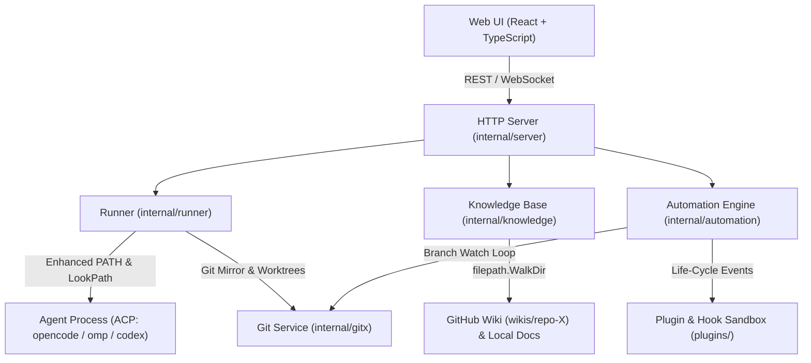

# xIssue 项目交接文档 (Handoff Document)

> 本文档用于记录 xIssue 在 `v0.2.10` 到 `v0.2.12` 期间的核心功能演进、架构改造、故障排查与后续开发规划，供后续开发、排障与持续迭代参考。

---

## 1. 项目概况与当前状态

- **项目名称**: xIssue (Personal AI Agent Issue & Multi-Repo Orchestrator)
- **最新发布版本**: `v0.2.12`
- **代码仓库**: `https://github.com/ffqa/xissue`
- **Homebrew Tap**: `https://github.com/ffqa/homebrew-tap` (`Formula/xissue.rb`)
- **本地服务监听**: `http://127.0.0.1:7789`
- **本地数据目录**: `~/.xissue` (包含 `xissue.db`, `config.yaml`, `xissue.log`, `mirrors/`, `runs/`, `wikis/`)
- **后台常驻服务**: macOS LaunchAgent (`~/Library/LaunchAgents/dev.xissue.plist`) / Linux systemd (`~/.config/systemd/user/xissue.service`)
- **当前验证状态**:
  - `go test -race ./...` 全部通过（包含 Knowledge、Runner、Automation、Gitx、Server 等全部测试）；
  - `pnpm --dir web build` 构建与类型检查全部通过；
  - macOS (arm64/amd64)、Linux (amd64/arm64)、Windows (amd64) 交叉编译全部通过；
  - 远端 GitHub Release 与 Homebrew Tap 均已同步完成。

---

## 2. 近期核心功能演进与改进

### 2.1 Git 监控交互精简与提交详情弹窗
- **精简交互**: 从分支监控卡片中彻底移除了容易造成误解与无意义操作的 `Cherry-Pick` 按钮，文案整体精简（“监控”、“最新推送”等）；
- **提交详情弹窗 ([`WatchCommitDetailModal.tsx`](file:///Users/gouki/server/ide/web/src/components/WatchCommitDetailModal.tsx))**:
  - 点击「📜 提交记录」可弹出查看该分支最近 25 条 Commit 列表；
  - 支持查看提交主题（Subject）、提交作者与原始提交时间；
  - 提供一键复制 Commit SHA；
  - 提供「在平台打开」直达外链（支持自动解析 GitHub、GitLab、Gitea 仓库 URL）；
  - 提供「基于此提交新建 Issue」，自动提取提交摘要与作者填入 Issue 创建表单。

### 2.2 自动化引擎联动分支推送与 DeepSeek Harness 级插件系统
- **自动化支持 `branch_push` 触发器**:
  - 在 [`internal/domain/domain.go`](file:///Users/gouki/server/ide/internal/domain/domain.go) 和 [`internal/automation/engine.go`](file:///Users/gouki/server/ide/internal/automation/engine.go) 中引入分支新提交触发器；
  - 过滤条件支持：分支名精确/正则匹配（`branch`）、提交作者过滤（`author`）、提交说明正则（`pattern`）；过滤基于本次推送的 tip commit（最新提交）；
  - 联动动作支持：自动新建 Issue（`create_issue`）、自动调度指定 Agent 执行（`trigger_run`）、自动拉取本地代码（`pull_local`）以及发送通知（`notify`）。
- **插件与 Hook 定制规范 ([`docs/PLUGINS_AND_HOOKS.md`](file:///Users/gouki/server/ide/docs/PLUGINS_AND_HOOKS.md))**:
  - 设计并落地了三层定制架构（Event Hooks、Filter/Enrich Plugins、Action Providers）；
  - 已落地的生命周期注入点（与代码一致）：`branch_push`、`pr_comment`、`pr_review`、`pr_merged`、`notification_dispatch`（仅插件）；`pr_created` 已在 Hook 检测清单中声明但尚未派发；`issue_created`、`issue_status_changed`、`run_started`、`run_finished`、`tool_call_intercept` 为后续规划项；
  - 带有 15 秒执行超时保护（Unix 下按进程组 SIGKILL，子进程不会残留），采用标准输入输出 JSON 契约通信，确保宿主程序永不死锁；项目级 Hook 仅对本地目录仓库执行，`pr_comment`/`pr_review` 另有作者信任门控；
- **开箱即用示例插件工程**:
  - [`plugins/follow-commit-watcher`](file:///Users/gouki/server/ide/plugins/follow-commit-watcher): 追踪指定提交合并后的第 N 次提交或特定作者提交，可查看指定文件内容与生成 Diff 摘要；
  - [`plugins/custom-notifier`](file:///Users/gouki/server/ide/plugins/custom-notifier): 全面扩展通知渠道（飞书卡片、企业微信 Markdown、钉钉、Bark 与 macOS 桌面原生通知）。

### 2.3 异机模型探测不可用排查与智能 PATH 方案
- **排查出的三大根因**:
  1. **常驻后台服务的 PATH 极其狭窄**: macOS LaunchAgent、Linux systemd 以及 `brew services` 启动常驻服务时，不会加载用户交互式 Shell（`.zshrc` / `.bashrc`）的环境变量，默认 PATH 仅有 `/usr/bin:/bin:/usr/sbin:/sbin`。用户在各机器上安装的 `opencode`、`omp`、`node/npx` 普遍位于 `~/.opencode/bin`、`/opt/homebrew/bin`、`~/.local/bin`、`~/.cargo/bin`、`~/.bun/bin`、`~/.nvm/...` 等路径，导致后端的 `exec.LookPath` 直接判定为“命令不存在”而放弃探测；
  2. **错误被静默吞掉**: 原先在探测 Agent 时，所有错误（LookPath 失败、命令执行失败、缺依赖、ACP 协商失败）全部被 `if err == nil` 吞掉，并直接返回空列表 `[]`，前端页面显示为空白，没有任何原因和操作指导；
  3. **配置文件路径跨系统差异**: 原先仅针对 macOS 硬编码了 `~/.config/opencode`，未适配 Windows（`%APPDATA%/opencode`）及 Linux 路径。
- **落地的根治措施**:
  - 新建 [`internal/runner/env.go`](file:///Users/gouki/server/ide/internal/runner/env.go)，提供 `EnsureEnhancedPath()` 和 `LookupAgentBinary()`：服务在 `main()` 启动时自动扫描注入系统与包管理器常见目录到 `PATH` 中；在执行探测和启动 Agent 时自动解析绝对路径；
  - 在 [`internal/runner/runner.go`](file:///Users/gouki/server/ide/internal/runner/runner.go) 的 `AgentModels` 中新增 `probeError` 字段；
  - 前端界面（[`AgentManagerModal.tsx`](file:///Users/gouki/server/ide/web/src/components/AgentManagerModal.tsx) 与 [`IssuePage.tsx`](file:///Users/gouki/server/ide/web/src/pages/IssuePage.tsx)）当检测到探测失败或未返回模型时，显示醒目的诊断提示条，精确提示具体原因并提供修复指引。

### 2.4 Wiki 知识库深层目录与弹窗滚动优化
- **Wiki 深层目录递归扫描**:
  - 在 [`internal/knowledge/knowledge.go`](file:///Users/gouki/server/ide/internal/knowledge/knowledge.go) 中将原有的单层 `os.ReadDir` 升级为 `filepath.WalkDir` 递归遍历，支持多级深层 Markdown 文件（例如 `guides/advanced/setup.md`）的扫描、全文搜索与持久化保存；
  - 前端在列表和搜索结果中增加目录标签展示（如 `📁 guides/advanced`），层级分明；
  - 增加深层目录单元测试 [`internal/knowledge/knowledge_test.go`](file:///Users/gouki/server/ide/internal/knowledge/knowledge_test.go)。
- **全局弹窗 Esc 键关闭体验**:
  - 通用组件 [`common.tsx`](file:///Users/gouki/server/ide/web/src/components/common.tsx)（`Modal`）升级在捕获阶段监听 `Escape` 键；
  - [`WatchCommitDetailModal.tsx`](file:///Users/gouki/server/ide/web/src/components/WatchCommitDetailModal.tsx) 和 [`MonitorModal.tsx`](file:///Users/gouki/server/ide/web/src/components/MonitorModal.tsx) 补齐 Esc 键关闭；
  - [`KnowledgeBaseModal.tsx`](file:///Users/gouki/server/ide/web/src/components/KnowledgeBaseModal.tsx) 中实现：编辑态下按 Esc 优先退出编辑状态，非编辑态下直接关闭弹窗。
- **Wiki 列表页与详情页滚动卡死根治**:
  - **根因**: CSS Flex 规范中子元素默认 `min-height: auto` 导致内容无限撑大容器，无法收缩触发 `overflowY: auto`；且外层 `.modal-b` 固有高度和 padding 产生了多余的外层滚动条，拦截了内层滚轮事件；
  - **修复**: 给 `Modal` 增加 `bodyStyle` 配置，消除外层滚动冲突；在左侧列表容器与右侧内容容器上显式声明 `minHeight: 0` 和 `overflowY: auto`，实现左侧列表与右侧长 Markdown 详情各自平滑独立滚动。

### 2.5 安全加固与工程化修复（v0.2.12）
- **知识库路径穿越修复（Critical）**:
  - `docID` 的 `relPath` 现经 `sanitizeDocRelPath` 校验（拒绝 `..`、绝对路径、盘符、NUL），并通过 `secureDocPath` 解析符号链接，防止读写逃逸出仓库/Wiki 目录；
  - 镜像文档读取同样校验 `repo.DefaultBranch`（`gitx.ValidateBranchName`）；
  - 覆盖读、写、symlink 逃逸与合法嵌套路径的测试位于 `internal/knowledge/knowledge_test.go` 与 `internal/server/security_test.go`。
- **配置并发安全与原子落盘**:
  - `config.Config` 增加 `RWMutex` 与快照/写入方法（`Agent`、`AgentsSnapshot`、`SetAgent`、`MonitorSnapshot`、`PermissionsSnapshot` 等），Runner/Watcher/Server 不再直接读写共享字段；
  - `Save()` 改为临时文件 + `fsync` + `rename`，避免 `config.yaml` 截断，并保持 `0600` 权限；补齐并发 `-race` 测试。
- **Hook/Plugin 边界收紧**:
  - `branch_push` / `pr_merged` 不再回退到其它仓库或 run worktree 执行 `.xissue/hooks`，仅本地目录仓库可执行；`branch_push` 另有 `shouldRunProjectHooks` 规则作者门控；
  - 15 秒超时改为按进程组 SIGKILL（Unix），并设置 `WaitDelay`，孙进程不会残留；
  - `plugin.yaml` 读取或 YAML 解析失败时插件默认禁用。
- **构建可复现**:
  - `.gitignore` 的 `dist/` 规则收窄为 `/dist/`，提交 `internal/server/dist/.gitkeep`，fresh clone 可直接 `go build ./cmd/xissue` 与 `go test ./...`。
- **文档对齐**:
  - HANDOFF/PLUGINS_AND_HOOKS/README/api.md 修正生命周期事件、MCP 目标、通知行为、鉴权要求与实际实现不一致之处。
- **验证结果**:
  - `go vet ./...`、`go test -count=1 -race ./...`、`gofmt`、前端 `tsc --noEmit` 全部通过；macOS/Linux/Windows 交叉编译通过。

---

## 3. 核心架构与关键代码索引



### 关键文件清单

| 模块 | 核心文件路径 | 关键职责说明 |
| :--- | :--- | :--- |
| **入口与环境** | [`cmd/xissue/main.go`](file:///Users/gouki/server/ide/cmd/xissue/main.go) | 程序启动入口，调用 `EnsureEnhancedPath()` 补齐环境变量 |
| **服务常驻** | [`cmd/xissue/service.go`](file:///Users/gouki/server/ide/cmd/xissue/service.go) | macOS LaunchAgent / Linux systemd 安装、卸载、状态查询与重启 |
| **跨平台信号** | [`cmd/xissue/kill_posix.go`](file:///Users/gouki/server/ide/cmd/xissue/kill_posix.go)<br>[`cmd/xissue/kill_windows.go`](file:///Users/gouki/server/ide/cmd/xissue/kill_windows.go) | 跨平台进程优雅终止与强制退出封装 |
| **环境与命令** | [`internal/runner/env.go`](file:///Users/gouki/server/ide/internal/runner/env.go) | 智能扫描用户目录并增强 PATH，`LookupAgentBinary` 解析可执行路径 |
| **Agent 调度** | [`internal/runner/runner.go`](file:///Users/gouki/server/ide/internal/runner/runner.go) | Agent 模型探测（带 `probeError`）、Run 状态机、工作区管理 |
| **知识库/Wiki** | [`internal/knowledge/knowledge.go`](file:///Users/gouki/server/ide/internal/knowledge/knowledge.go) | Wiki 与本地 Docs 递归扫描、全文搜索、正文读取与持久化保存 |
| **知识库测试** | [`internal/knowledge/knowledge_test.go`](file:///Users/gouki/server/ide/internal/knowledge/knowledge_test.go) | 包含深层 Wiki 目录与搜索的自动化测试 |
| **自动化引擎** | [`internal/automation/engine.go`](file:///Users/gouki/server/ide/internal/automation/engine.go) | 自动化规则评估、分支推送触发、动作派发与 Hook 事件派发 |
| **插件系统文档** | [`docs/PLUGINS_AND_HOOKS.md`](file:///Users/gouki/server/ide/docs/PLUGINS_AND_HOOKS.md) | Hook 与插件编写方案、注入点数据契约、调试指南 |
| **示例插件** | [`plugins/follow-commit-watcher/`](file:///Users/gouki/server/ide/plugins/follow-commit-watcher/) | 提交跟进、深层文件内容查看与 Diff 分析示例插件 |
| **通知插件** | [`plugins/custom-notifier/`](file:///Users/gouki/server/ide/plugins/custom-notifier/) | 扩展飞书、钉钉、企微、Bark、macOS 桌面通知的示例插件 |
| **通用弹窗** | [`web/src/components/common.tsx`](file:///Users/gouki/server/ide/web/src/components/common.tsx) | 统一 `Modal` 组件，支持 Esc 监听、`bodyStyle` 定制 |
| **知识库弹窗** | [`web/src/components/KnowledgeBaseModal.tsx`](file:///Users/gouki/server/ide/web/src/components/KnowledgeBaseModal.tsx) | 深层目录展示、独立滚动区域、Markdown 预览与实时编辑 |
| **提交详情弹窗** | [`web/src/components/WatchCommitDetailModal.tsx`](file:///Users/gouki/server/ide/web/src/components/WatchCommitDetailModal.tsx) | 分支历史 Commit 详情查看、外链跳转、一键生成 Issue |
| **监控弹窗** | [`web/src/components/MonitorModal.tsx`](file:///Users/gouki/server/ide/web/src/components/MonitorModal.tsx) | 分支监控状态、即时触发、活跃时间段配置与日志查看 |

---

## 4. 验证与测试命令备忘

在本地开发与发版前，可使用以下命令集进行全面验证：

```bash
# 1. 运行全部 Go 单元测试（带并发竞态检测）
go test -count=1 -race ./...

# 2. 前端 TypeScript 类型检查与静态资源构建
pnpm --dir web build

# 3. 跨平台多架构交叉编译验证
GOOS=darwin  GOARCH=arm64 go build -o /dev/null ./cmd/xissue
GOOS=darwin  GOARCH=amd64 go build -o /dev/null ./cmd/xissue
GOOS=linux   GOARCH=amd64 go build -o /dev/null ./cmd/xissue
GOOS=linux   GOARCH=arm64 go build -o /dev/null ./cmd/xissue
GOOS=windows GOARCH=amd64 go build -o /dev/null ./cmd/xissue

# 4. 本地服务热更新与重启
go build -o bin/xissue ./cmd/xissue
cp bin/xissue ~/.local/bin/xissue
codesign -s - -f ~/.local/bin/xissue
xissue service restart

# 5. 验证健康检查与 Agent 探测
curl -sS http://127.0.0.1:7789/api/health
curl -sS "http://127.0.0.1:7789/api/agents/opencode/models?refresh=1"
```

---

## 5. 后续演进与迭代建议 (Next Steps)

1. **知识库 Wiki 树状折叠视图**:
   - 当前已支持按深层路径解析并展示 `📁 guides/advanced` 标签；
   - 后续可升级为可折叠的树形目录（Tree View），对于拥有几十篇甚至上百篇 Wiki 文档的大型仓库体验更佳。
2. **监控任务热重启平滑衔接**:
   - 当正在执行监控拉取或调度任务时，如果用户执行 `xissue service restart`，服务已支持优雅退出与端口等待；
   - 后续可加入持久化的任务状态快照，在进程重启后自动恢复未完成的短任务。
3. **插件可视化管理界面**:
   - 当前插件通过 `~/.xissue/config.yaml` 或项目配置声明并执行外部脚本；
   - 后续可在 Web 端增加「插件市场 / 插件管理」面板，方便一键启停插件并配置参数。
