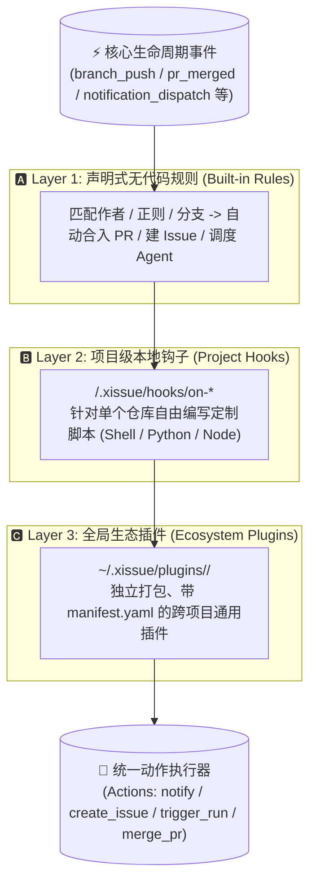

# xIssue 扩展与插件开发指南（Harness Hooks & Plugin System）

> **设计目标**：如同 DeepSeek Harness / Modern Agent Harness 一样，将代码监控、任务调度、审查合入、通知流转的全生命周期全面解耦，所有环节均可高度定制与插拔。

---

## 🏛️ 一、三层扩展架构模型 (Three-Tier Extensibility)

xIssue 采用分层递进的自动化扩展架构：



1. **Layer 1（声明式规则）**：在 Web 界面无需编写一行代码，通过条件匹配（分支名、提交人、正文正则）触发预置动作；
2. **Layer 2（项目级 Hooks）**：代码库特定逻辑（如拉取后自动跑代码生成、特定编译、私有校验），放在代码库根目录 `.xissue/hooks/` 下，跟随 Git 仓库版本管理；
3. **Layer 3（生态插件 Plugins）**：跨项目复用的扩展包（如自定义通知渠道、复杂的多分支提交追踪器、第三方项目管理平台双向同步），存放在 `~/.xissue/plugins/` 下。

---

## 🔌 二、全生命周期注入点矩阵 (Lifecycle Injection Points)

无论编写 Layer 2 的 Hook 脚本，还是 Layer 3 的插件，均监听以下标准注入点（下表为**当前代码实际派发**的事件）：

| 注入点 (Event Name) | 对应 Hook 脚本名 | 触发时机与典型应用场景 |
| :--- | :--- | :--- |
| `branch_push` | `on-branch-push` | **监控分支收到新代码推送**：触发后续提交追踪、自动建 Issue、拉取镜像、运行 Agent 分析审查 |
| `pr_created` | `on-pr-created` | **xIssue 成功创建 PR**：发送通知、记录 PR 元数据、触发外部审查 |
| `pr_merged` | `on-pr-merged` | **PR 成功合并到目标分支**：记录合并基准点、重置后续提交计数、触发部署流水线或通知 |
| `notification_dispatch` | `on-notify` | **系统发出通知**：扩展飞书卡片、企业微信、钉钉加签、Bark、Slack、macOS 桌面横幅等渠道 |
| `pr_comment` | `on-pr-comment` | **PR 收到新评论或检查报告**：识别 QA 报告或 Bot 指令自动合入 PR 或打标签 |
| `pr_review` | `on-pr-review` | **PR 收到审核批准 (Review)**：指定审核人 Approved 后自动触发合入 |
| `issue_created` | `on-issue-created` | **本地或远程 Issue 首次创建**：自动打标、外部系统同步、自定义通知 |
| `issue_status_changed` | `on-issue-status-changed` | **Issue 状态变化**：同步 Jira/Linear、审计状态流转、通知负责人 |
| `run_started` | `on-run-started` | **Agent Run 开始**：写入审计日志、设置外部计时器 |
| `run_finished` | `on-run-finished` | **Run 完成、失败或取消**：审计日志、失败告警、派生后续任务 |

> 尚未实现派发的注入点：`tool_call_intercept`。请勿依赖该事件编写线上插件。

### 事件动作支持范围

不同事件拥有不同的上下文与安全边界：

| 事件 | 支持执行的 Action |
| :--- | :--- |
| `branch_push`、`pr_comment`、`pr_review` | 全部：`notify`、`add_labels`、`create_issue`、`trigger_run`、`pull_local`、`merge_pr`、`set_issue_status` |
| `pr_merged` | `notify`、`pull_local`、`set_issue_status`（`merge_pr` 会被忽略，避免重复合并） |
| `issue_created`、`issue_status_changed` | `notify`、`add_labels`（自动打标、分流、同步外部状态） |
| `run_finished` | `notify`、`add_labels`、`create_issue`（失败复盘、派生后续任务、复核 Issue） |
| `pr_created` | `notify`、`add_labels`、`trigger_run`（自动启动 PR 审查 Agent；不允许多级递归） |
| `run_started`、`notification_dispatch` | 仅 `notify`；其余动作会被记录并忽略，防止事件递归与 Token 失控 |

事件回调始终执行插件；插件返回的 Action 由上述白名单决定是否落地。生命周期事件的上下文包含 `issue`、`run`、`previousStatus`、`timestamp` 等字段。`create_issue` 只允许在 `run_finished` 落地，`trigger_run` 只允许在 `pr_created` 落地，避免插件通过生命周期事件形成无限循环。

---

## 🧩 二点五、插件契约 v1、安装与生态仓库

### 1. `plugin.yaml` v1

```yaml
apiVersion: 1
name: my-plugin          # 小写 id，同时作为安装目录名
version: 1.0.0
description: 一句话说明
author: your-name
entrypoint: run.py       # 相对路径，不允许绝对路径或 .. 逃逸
events:
  - issue_created
  - run_finished
permissions:             # 仅声明与审计，不是沙箱
  - notify
  - network
```

校验规则（不满足时插件保持禁用并在 UI/CLI 显示错误）：

- `apiVersion` 必须为 `1`（旧清单缺省视为 v1）；
- `name` 必须匹配 `^[a-z0-9][a-z0-9._-]{0,63}$`；
- `events` 非空且只能使用上表事件名或 `all` / `*`；
- `entrypoint` 必须位于插件目录内，禁止绝对路径、`..` 与符号链接逃逸；
- `permissions` 仅允许 `repo:read`、`repo:write`、`network`、`notify`、`process`；
- `ui.entry`（可选）必须是以 `ui/` 开头的相对路径，文件必须存在；`ui.slots` 只能使用 `project.page`、`project.header`、`issue.page`、`issue.actions`；
- 清单损坏、事件未知、UI 路径逃逸或 entrypoint 缺失时 fail-closed。

JSON Schema 见仓库 [`schemas/plugin.schema.json`](../schemas/plugin.schema.json)。

### 2. 安装命令

```bash
# 从官方目录安装
xissue plugin install custom-notifier

# 从任意 GitHub 仓库安装
xissue plugin install your-github-user/your-plugin

# monorepo 子目录
xissue plugin install your-github-user/monorepo --path plugins/my-plugin

# 本地开发
xissue plugin check .
ln -s "$PWD" ~/.xissue/plugins/my-plugin

xissue plugin list
xissue plugin disable my-plugin
xissue plugin enable my-plugin
```

安装器会 `git clone --depth 1`、校验 manifest、复制到
`~/.xissue/plugins/<name>`（或 `-data-dir` 对应的 `plugins/`）。默认不覆盖已有安装，使用 `--force` 替换。目录索引可通过 `--catalog` 或 `XISSUE_PLUGIN_INDEX` 覆盖。

- 官方模板仓库：<https://github.com/ffqa/xissue-plugin-template>
- 官方插件目录：<https://github.com/ffqa/xissue-plugins>（`index.json` 为机器可读索引）
- 当前目录插件：`custom-notifier`、`follow-commit-watcher`、`slack-notifier`、`run-audit`、`commit-file-linker`、`ui-demo`

### 3. 执行模型与安全边界

- 插件以当前用户权限运行，manifest 的 `permissions` **不会**限制文件、网络或子进程访问；只安装你信任的代码。
- 每次调用 15 秒超时；Unix 下以独立进程组启动，超时后整组 SIGKILL。
- Python entrypoint 使用 `python3`，JavaScript 使用 `node`，其他 entrypoint 直接执行。
- 插件目录即工作目录；状态文件应写入插件目录或显式配置的路径。
- Layer 2 项目 Hook 仍仅对本地目录仓库执行；远程镜像与 run worktree 中的脚本不会被执行。

### 3.5 插件 UI（同源 iframe + 插槽）

在 manifest 中声明 UI：

```yaml
ui:
  entry: ui/index.html   # 必须位于 ui/ 下
  title: Issue dashboard
  slots:                 # 留空则只有独立页面
    - project.header
    - issue.actions
```

- 独立页面：`/plugins/<id>`，由顶栏「🧩 插件管理」中的「打开插件页面」进入；
- 插槽：`project.header` / `project.page` / `issue.actions` / `issue.page`，由宿主页面自动挂载同一 UI；
- 权限：插件是操作者自行安装的可信扩展。默认 iframe 与主应用同源、**不设置 sandbox**，可访问 `parent.document`、Cookie、localStorage、`fetch` 等主应用权限；`postMessage` 只是便捷桥，不是安全边界；
- 全局开关：设置 → 通用 → 🧩 插件 UI →「插件 UI 沙盒模式」。默认关闭；开启后 iframe 使用 `sandbox="allow-scripts allow-forms allow-popups allow-downloads"`（不含 `allow-same-origin`），插件只能通过 `postMessage` 桥通信。配置字段为 `pluginUISandbox`（默认 `false`）；
- 静态资源只从 `<plugin>/ui/` 提供（`GET /api/plugins/{id}/ui/{path...}`），后端拒绝 `..` 与符号链接逃逸；
- `postMessage` 小桥：
  - 插件 → 宿主：`xissue:ready`、`xissue:notify{kind,message}`、`xissue:open{path}`（仅接受 `/` 开头的站内路径）、`xissue:reload`、`xissue:resize{height}`；
  - 宿主 → 插件：`xissue:context{slot,context}`，`context` 包含页面 id/key/状态等字段；
  - 未开启沙盒时，插件可直接在同源 iframe 内操作宿主页面或调用 `/api/*`；开启后只能使用上述消息桥；
- 示例 plugin 见 [`examples/plugin-ui`](../examples/plugin-ui)。

### 4. Web 全局管理与 `config.json`

- 顶栏「🧩 插件」打开全局插件管理器，按 `plugins/` 目录聚合所有项目的插件，不再需要进入单个项目页；
- 支持即时启用/停用：停用写入 `.disabled`，下一次事件派发前检查，**停用后不会再触发**；启用会移除该文件并重新校验 manifest；
- 左侧列表显示 manifest 错误、API 版本、事件与权限；右侧提供 `README.md` 预览与 `config.json` 编辑器；
- `config.json` 可直接在界面生成、编辑、保存（原子写入，权限 `0600`）。首次生成时优先复制同目录的 `config.example.json`，没有模板则写入 `{}`；
- 插件进程以插件目录为工作目录，脚本可直接读取 `./config.json`；配置不会自动注入 stdin payload，避免改变既有插件契约；
- API：`GET /api/plugins`、`GET /api/plugins/{id}/readme`、`GET /api/plugins/{id}/ui/{path...}`、`GET|PUT /api/plugins/{id}/config`、`PATCH /api/plugins/{id}`（`{enabled}`）。

---

## 📦 三、输入输出数据契约 (Data Contracts)

xIssue 通过标准输入（`stdin`）将上下文信息以 JSON 格式传递给 Hook/插件脚本；脚本通过标准输出（`stdout`）向 xIssue 返回需要执行的指令动作。

### 1. 输入数据载荷 (`stdin` JSON Payload)

```json
{
  "event": "branch_push",
  "project": {
    "id": 1,
    "name": "my-project",
    "targetBranch": "main"
  },
  "repo": {
    "id": 10,
    "name": "web-frontend",
    "provider": "github",
    "remoteUrl": "/Users/user/code/web-frontend",
    "ownerRepo": "myorg/web-frontend",
    "defaultBranch": "main"
  },
  "branch": "main",
  "tipSha": "34639b4f9812e...",
  "commits": [
    {
      "sha": "34639b4f9812e...",
      "shortSha": "34639b4",
      "subject": "feat: add user login",
      "author": "alice",
      "date": "2026-10-20 20:15:00 +0800"
    }
  ],
  "notification": {
    "kind": "branch_push",
    "title": "分支推送：web-frontend:main",
    "body": "• 34639b4 feat: add user login (alice)",
    "link": "/projects/1?watch=2",
    "timestamp": "2026-10-20T20:15:00+08:00"
  }
}
```

### 2. 输出指令动作 (`stdout` JSON Actions)

如果 Hook/插件需要让 xIssue 协助执行系统动作，只需在退出前向 `stdout` 输出如下 JSON（若仅执行外部逻辑，可直接输出空内容）：

```json
{
  "actions": [
    {
      "type": "notify",
      "message": "自定义通知内容，支持 Markdown"
    },
    {
      "type": "add_labels",
      "labels": ["needs-review", "auto"]
    },
    {
      "type": "create_issue",
      "prompt": "[自动跟进] 发现关键改动，自动创建 Issue",
      "labels": ["follow-up", "auto"]
    },
    {
      "type": "trigger_run",
      "agent": "opencode",
      "prompt": "请分析最新提交的代码差异并进行单元测试覆盖审查"
    },
    {
      "type": "pull_local"
    },
    {
      "type": "merge_pr",
      "strategy": "squash"
    },
    {
      "type": "set_issue_status",
      "status": "done"
    }
  ]
}
```

---

## 🛠️ 四、实战一：编写「本人提交合并后的第 N 次提交」追踪插件

用户常见需求：*“我的 PR 合并后，我想追踪主线分支接下来的第 1 次或前 3 次提交，看别人有没有改坏我的模块，或者直接查看该提交下的指定文件与 Diff。”*

内置完整实现详见官方插件仓库：[`follow-commit-watcher`](https://github.com/ffqa/xissue-plugins/tree/main/plugins/follow-commit-watcher)。

### 1. 插件结构
```
follow-commit-watcher/
├── plugin.yaml          # 插件清单 (声明监听 branch_push 与 pr_merged)
├── run.py               # 核心逻辑 (Python 3 标准库，无外部依赖)
├── config.example.json  # 示例配置 (关注作者、关注文件、镜像目录)
└── README.md
```

### 2. 插件元数据 `plugin.yaml`
```yaml
apiVersion: 1
name: follow-commit-watcher
version: 1.1.0
description: 追踪合并后或指定作者的后续提交，提取文件预览并通知
author: ffqa
entrypoint: run.py
events:
  - branch_push
  - pr_merged
permissions:
  - repo:read
  - process
  - notify
```

### 3. 查看指定文件内容与 Diff 的核心实现技巧
在插件的 Python 脚本中，直接调用 Git 标准工具链即可轻松获取文件与 Diff：

```python
# 1. 获取该提交涉及的变更文件清单
changed_files = subprocess.check_output(
    ["git", "show", "--name-only", "--pretty=format:", commit_sha],
    cwd=repo_dir, text=True
).splitlines()

# 2. 查看指定提交下的特定文件内容 (无需 checkout，安全无副作用)
file_content = subprocess.check_output(
    ["git", "show", f"{commit_sha}:package.json"],
    cwd=repo_dir, text=True
)

# 3. 获取该提交的完整变更差异统计 (Diff Stat)
diff_stat = subprocess.check_output(
    ["git", "show", "--stat", "--oneline", commit_sha],
    cwd=repo_dir, text=True
)
```

---

## 📢 五、实战二：像 DeepSeek Harness 一样定制通知渠道

内置完整实现详见官方插件仓库：[`custom-notifier`](https://github.com/ffqa/xissue-plugins/tree/main/plugins/custom-notifier)。

### 1. 监听 `notification_dispatch`
只需在 `plugin.yaml` 中声明：
```yaml
apiVersion: 1
name: custom-notifier
version: 1.1.0
entrypoint: run.py
events:
  - notification_dispatch
permissions:
  - network
  - process
```

### 2. 派发到任意平台
插件运行时从 `payload["notification"]` 获取通知内容，即可任意分发：

#### 派发到 macOS 原生桌面横幅
```python
script = "on run argv\ndisplay notification (item 2 of argv) with title (item 1 of argv)\nend run"
subprocess.run(["osascript", "-e", script, title[:120], body.replace("\n", " ")[:180]])
```
使用 `argv` 传参，避免把通知正文拼接进 AppleScript 造成注入。

#### 派发到飞书富文本互动卡片
```python
payload = {
    "msg_type": "interactive",
    "card": {
        "header": {"title": {"tag": "plain_text", "content": f"🔔 {title}"}, "template": "blue"},
        "elements": [{"tag": "div", "text": {"tag": "lark_md", "content": f"{body}\n\n[点击查看]({link})"}}]
    }
}
urllib.request.urlopen(urllib.request.Request(feishu_url, data=json.dumps(payload).encode("utf-8"), headers={"Content-Type": "application/json"}))
```

#### 派发到企业微信 Markdown 消息
```python
payload = {
    "msg_type": "markdown",
    "markdown": {"content": f"### {title}\n\n{body}\n\n[查看详情]({link})"}
}
urllib.request.urlopen(urllib.request.Request(wecom_url, data=json.dumps(payload).encode("utf-8"), headers={"Content-Type": "application/json"}))
```

#### 派发到 Bark (iOS 手机通知)
```python
bark_url = f"https://api.day.app/{bark_key}/{urllib.parse.quote(title)}/{urllib.parse.quote(body)}?url={urllib.parse.quote(link)}"
urllib.request.urlopen(bark_url)
```

---

## 🛡️ 六、执行安全与沙箱保护机制

1. **执行超时熔断**：每个 Hook 或插件进程拥有 **15 秒执行超时保护**；Unix 下命令以独立进程组启动，超时后整组 SIGKILL，孙进程不会残留（Windows 仅终止直接子进程）；
2. **安全信任边界**：
   - 项目级 Layer 2 Hook 仅从**本地目录添加的仓库**执行；远程镜像仓库、run worktree 中的 `.xissue/hooks` 不会被执行；
   - `pr_comment` / `pr_review` 只有评论作者等于 PR 作者或被任意自动化规则显式点名的作者才会触发 Hook；
   - `branch_push` 仅对本地目录仓库执行，且需满足 `shouldRunProjectHooks`（非本地来源还要求作者属于规则白名单）；
3. **清单失败即禁用**：`plugin.yaml` 缺失、解析失败、API 版本不支持、事件未知或 entrypoint 逃逸时，插件 `Enabled=false`，不会被意外启用；
4. **独立进程空间**：插件以独立子进程运行，崩溃或异常退出不会影响 xIssue 自身稳定性；
5. **权限声明不是沙箱**：`permissions` 仅用于审计与 UI 展示。插件以当前用户身份运行，可读写文件、访问网络、启动子进程；请只安装可信代码；
6. **生命周期动作白名单**：`issue_created` / `issue_status_changed` 可 `add_labels`；`run_finished` 可 `add_labels` / `create_issue`；`pr_created` 可 `add_labels` / `trigger_run`；`run_started` 与 `notification_dispatch` 仅 `notify`；`pr_merged` 忽略 `merge_pr`；
7. **日志审计**：Hook/Plugin 非零退出时，其 `stderr` 会随错误写入监控日志；目前不会逐行实时转发插件输出。

---

## 🔍 七、本地调试技巧

无需等待后台事件触发，可以直接在终端中通过管道喂入 Mock JSON 进行毫秒级本地测试：

```bash
# 校验清单
xissue plugin check .

# 测试 follow-commit-watcher 插件（官方插件仓库）
git clone https://github.com/ffqa/xissue-plugins /tmp/xissue-plugins
cat << 'EOF' | python3 /tmp/xissue-plugins/plugins/follow-commit-watcher/run.py
{
  "event": "branch_push",
  "branch": "main",
  "commits": [
    {
      "sha": "HEAD",
      "shortSha": "HEAD",
      "subject": "feat: release new version",
      "author": "release-bot"
    }
  ]
}
EOF
```

控制台会即时输出生成的 Action JSON，确保上线运行零失误。模板仓库提供 `fixtures/` 与 `scripts/validate_manifest.py`，可直接在 CI 中复跑。
