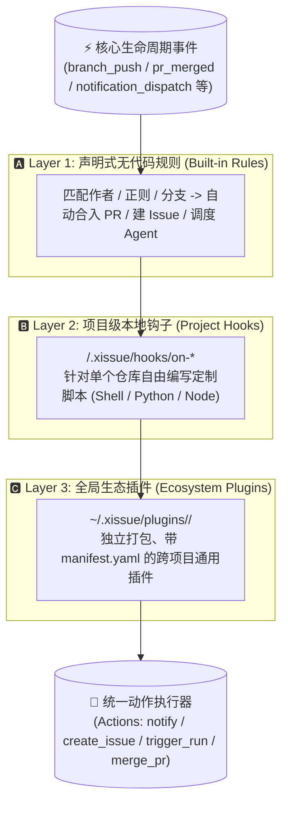

# xIssue 扩展与插件开发指南（Harness Hooks & Plugin System）

> **设计目标**：如同 DeepSeek Harness / Modern Agent Harness 一样，将代码监控、任务调度、审查合入、通知流转的全生命周期全面解耦，所有环节均可高度定制与插拔。

---

## 🏛️ 一、三层扩展架构模型 (Three-Tier Extensibility)

xIssue 采用分层递进的自动化扩展架构：



1. **Layer 1（声明式规则）**：在 Web 界面无需编写一行代码，通过条件匹配（分支名、提交人、正文正则）触发预置动作；
2. **Layer 2（项目级 Hooks）**：代码库特定逻辑（如拉取后自动跑代码生成、特定编译、私有校验），放在代码库根目录 `.xissue/hooks/` 下，跟随 Git 仓库版本管理；
3. **Layer 3（生态插件 Plugins）**：跨项目复用的扩展包（如自定义通知渠道、复杂的多分支提交追踪器、第三方项目管理平台双向同步），存放在 `~/.xissue/plugins/` 下。

---

## 🔌 二、全生命周期注入点矩阵 (Lifecycle Injection Points)

无论编写 Layer 2 的 Hook 脚本，还是 Layer 3 的插件，均监听以下标准注入点：

| 注入点 (Event Name) | 对应 Hook 脚本名 | 触发时机与典型应用场景 |
| :--- | :--- | :--- |
| `branch_push` | `on-branch-push` | **监控分支收到新代码推送**：触发后续提交追踪、自动建 Issue、拉取镜像、运行 Agent 分析审查 |
| `pr_merged` | `on-pr-merged` | **PR 成功合并到目标分支**：记录合并基准点、重置后续提交计数、触发部署流水线或通知 |
| `notification_dispatch`| `on-notify` | **系统发出通知**：接管或扩展通知渠道（扩展飞书卡片、企业微信、钉钉加签、Bark、macOS 桌面横幅等） |
| `pr_created` | `on-pr-created` | **本地任务提交并创建新 PR 成功**：自动向团队群推送 PR 审查邀请、触发 CI 预检 |
| `pr_comment` | `on-pr-comment` | **PR 收到新评论或检查报告**：识别 QA 报告或 Bot 指令自动合入 PR 或打标签 |
| `pr_review` | `on-pr-review` | **PR 收到审核批准 (Review)**：指定审核人 Approved 后自动触发合入 |

---

## 📦 三、输入输出数据契约 (Data Contracts)

xIssue 通过标准输入（`stdin`）将上下文信息以 JSON 格式传递给 Hook/插件脚本；脚本通过标准输出（`stdout`）向 xIssue 返回需要执行的指令动作。

### 1. 输入数据载荷 (`stdin` JSON Payload)

```json
{
  "event": "branch_push",
  "project": {
    "id": 1,
    "name": "my-project",
    "targetBranch": "main"
  },
  "repo": {
    "id": 10,
    "name": "web-frontend",
    "provider": "github",
    "remoteUrl": "/Users/user/code/web-frontend",
    "ownerRepo": "myorg/web-frontend",
    "defaultBranch": "main"
  },
  "branch": "main",
  "tipSha": "34639b4f9812e...",
  "commits": [
    {
      "sha": "34639b4f9812e...",
      "shortSha": "34639b4",
      "subject": "feat: add user login",
      "author": "alice",
      "date": "2026-10-20 20:15:00 +0800"
    }
  ],
  "notification": {
    "kind": "branch_push",
    "title": "分支推送：web-frontend:main",
    "body": "• 34639b4 feat: add user login (alice)",
    "link": "/projects/1?watch=2",
    "timestamp": "2026-10-20T20:15:00+08:00"
  }
}
```

### 2. 输出指令动作 (`stdout` JSON Actions)

如果 Hook/插件需要让 xIssue 协助执行系统动作，只需在退出前向 `stdout` 输出如下 JSON（若仅执行外部逻辑，可直接输出空内容）：

```json
{
  "actions": [
    {
      "type": "notify",
      "message": "自定义通知内容，支持 Markdown"
    },
    {
      "type": "create_issue",
      "prompt": "[自动跟进] 发现关键改动，自动创建 Issue"
    },
    {
      "type": "trigger_run",
      "agent": "opencode",
      "prompt": "请分析最新提交的代码差异并进行单元测试覆盖审查"
    },
    {
      "type": "pull_local"
    },
    {
      "type": "merge_pr",
      "strategy": "squash"
    },
    {
      "type": "set_issue_status",
      "status": "done"
    }
  ]
}
```

---

## 🛠️ 四、实战一：编写「本人提交合并后的第 N 次提交」追踪插件

用户常见需求：*“我的 PR 合并后，我想追踪主线分支接下来的第 1 次或前 3 次提交，看别人有没有改坏我的模块，或者直接查看该提交下的指定文件与 Diff。”*

内置完整实现详见项目目录：[`plugins/follow-commit-watcher`](file:///Users/gouki/server/ide/plugins/follow-commit-watcher)。

### 1. 插件结构
```
plugins/follow-commit-watcher/
├── plugin.yaml          # 插件清单 (声明监听 branch_push 与 pr_merged)
├── run.py               # 核心逻辑 (Python 3 标准库，无外部依赖)
└── config.json          # 自定义配置 (指定关注作者、关注的文件清单)
```

### 2. 插件元数据 `plugin.yaml`
```yaml
name: follow-commit-watcher
version: 1.0.0
description: 追踪本人或指定作者提交被合并后的后续第 N 次提交变动，可提取指定文件并生成 Diff 摘要发通知
author: Developer
entrypoint: run.py
events:
  - branch_push
  - pr_merged
```

### 3. 查看指定文件内容与 Diff 的核心实现技巧
在插件的 Python 脚本中，直接调用 Git 标准工具链即可轻松获取文件与 Diff：

```python
# 1. 获取该提交涉及的变更文件清单
changed_files = subprocess.check_output(
    ["git", "show", "--name-only", "--pretty=format:", commit_sha],
    cwd=repo_dir, text=True
).splitlines()

# 2. 查看指定提交下的特定文件内容 (无需 checkout，安全无副作用)
file_content = subprocess.check_output(
    ["git", "show", f"{commit_sha}:package.json"],
    cwd=repo_dir, text=True
)

# 3. 获取该提交的完整变更差异统计 (Diff Stat)
diff_stat = subprocess.check_output(
    ["git", "show", "--stat", "--oneline", commit_sha],
    cwd=repo_dir, text=True
)
```

---

## 📢 五、实战二：像 DeepSeek Harness 一样定制通知渠道

内置完整实现详见项目目录：[`plugins/custom-notifier`](file:///Users/gouki/server/ide/plugins/custom-notifier)。

### 1. 监听 `notification_dispatch`
只需在 `plugin.yaml` 中声明：
```yaml
name: custom-notifier
version: 1.0.0
entrypoint: run.py
events:
  - notification_dispatch
```

### 2. 派发到任意平台
插件运行时从 `payload["notification"]` 获取通知内容，即可任意分发：

#### 派发到 macOS 原生桌面横幅
```python
clean_title = title.replace('"', '\\"')
clean_body = body.replace('"', '\\"').replace("\n", " ")[:120]
subprocess.run(["osascript", "-e", f'display notification "{clean_body}" with title "{clean_title}"'])
```

#### 派发到飞书富文本互动卡片
```python
payload = {
    "msg_type": "interactive",
    "card": {
        "header": {"title": {"tag": "plain_text", "content": f"🔔 {title}"}, "template": "blue"},
        "elements": [{"tag": "div", "text": {"tag": "lark_md", "content": f"{body}\n\n[点击查看]({link})"}}]
    }
}
urllib.request.urlopen(urllib.request.Request(feishu_url, data=json.dumps(payload).encode("utf-8"), headers={"Content-Type": "application/json"}))
```

#### 派发到企业微信 Markdown 消息
```python
payload = {
    "msg_type": "markdown",
    "markdown": {"content": f"### {title}\n\n{body}\n\n[查看详情]({link})"}
}
urllib.request.urlopen(urllib.request.Request(wecom_url, data=json.dumps(payload).encode("utf-8"), headers={"Content-Type": "application/json"}))
```

#### 派发到 Bark (iOS 手机通知)
```python
bark_url = f"https://api.day.app/{bark_key}/{urllib.parse.quote(title)}/{urllib.parse.quote(body)}?url={urllib.parse.quote(link)}"
urllib.request.urlopen(bark_url)
```

---

## 🛡️ 六、执行安全与沙箱保护机制

1. **执行超时熔断**：每个 Hook 或插件进程拥有 **15 秒执行超时保护**，超时后进程树自动被 SIGKILL 终止，绝不挂起主服务或阻塞监控循环；
2. **安全信任隔离**：外部未认证人员发起的 PR 评论，受安全保护策略限制，禁止触发本地 Layer 2 脚本，杜绝外部 RCE；
3. **独立进程空间**：插件以独立子进程运行，崩溃或异常退出不会影响 xIssue 自身稳定性；
4. **统一日志审计**：插件的 `stderr` 输出与执行状态会实时记录在 xIssue 日志系统（`~/.xissue/xissue.log`），可在 Web 监控面板的「实时日志」中直观排查。

---

## 🔍 七、本地调试技巧

无需等待后台事件触发，可以直接在终端中通过管道喂入 Mock JSON 进行毫秒级本地测试：

```bash
# 测试 follow-commit-watcher 插件
cat << 'EOF' | python3 plugins/follow-commit-watcher/run.py
{
  "event": "branch_push",
  "branch": "main",
  "commits": [
    {
      "sha": "HEAD",
      "shortSha": "HEAD",
      "subject": "feat: release new version",
      "author": "release-bot"
    }
  ]
}
EOF
```

控制台会即时输出生成的 Action JSON，确保上线运行零失误。
