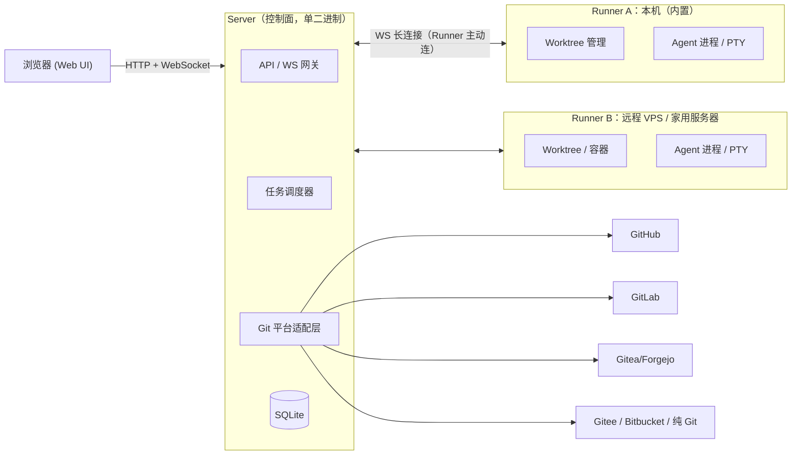
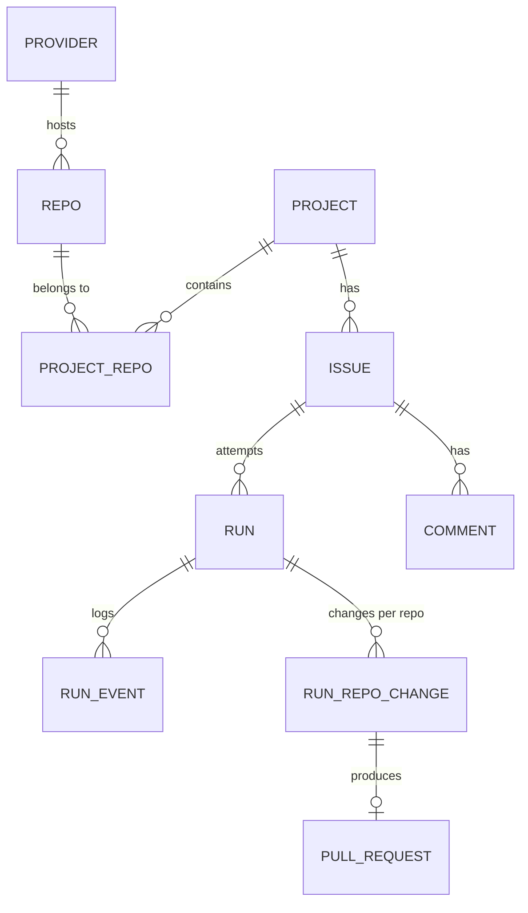
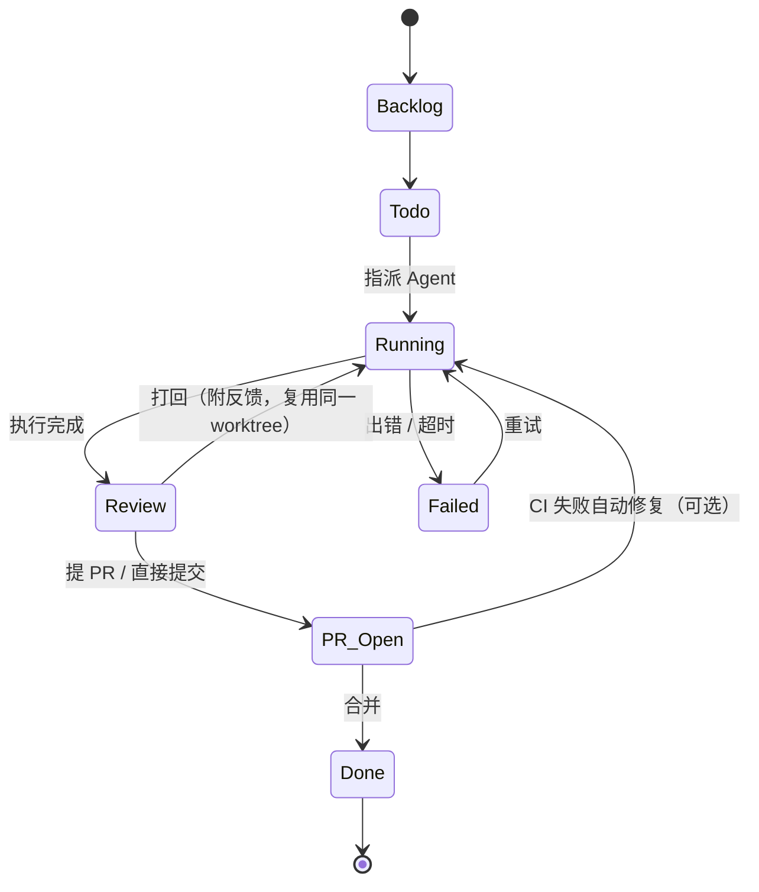

# 设计草案：个人 AI Agent 任务编排工具（xpier-issue）

## 1. 定位

- **单用户**，以 server + Web UI 方式部署在任意机器上。
- 监听 `127.0.0.1` 或 Tailscale 网段。**默认不做登录**，可选一个静态 Token 兜底。
- 核心工作流：**Issue → 指派 Agent → 隔离执行 → 审查 Diff → 提交 / 提 PR → 留档回顾**。
- 编辑器是辅助功能：只做 Monaco 查看加小改，重度编辑通过深链跳到 VSCode 或 Cursor（Remote-SSH / Tailscale）。

---

## 2. 总体架构：控制面 + 执行面分离



**要点**
- **Server 内置一个本地 Runner**。第一阶段只有一个进程：部署在哪台机器，就在哪台机器上跑 Agent。
  - 直接把整套部署到一台常开的远程机器，就已经能 7×24 运行。
- 第二阶段把 Runner 拆成独立二进制，**由 Runner 主动连接 Server**。这样不需要打洞，走 Tailscale 也很自然。
  - 可以同时挂多台执行机，比如 Mac 本机和 Linux VPS。
- Agent 进程**不依赖浏览器连接**。关掉页面任务照样运行，日志全部落盘，重新打开可以回放。

---

## 3. 核心领域模型



| 实体 | 说明 |
|---|---|
| **Provider** | Git 平台实例和凭证，例如 `github.com`、`gitlab.mycorp.com`、`gitea.home`、`plain-git` |
| **Repo** | 一个 Git 仓库：remote URL、默认分支、本地镜像路径、仓库级规则（测试命令、AGENTS.md） |
| **Project** | 1..N 个 Repo 的组合。**单仓项目 = 只含 1 个 Repo 的 Project**，两种情况统一成一个模型 |
| **Issue** | 统一任务实体。`source = remote / local`，见下文 |
| **Run** | 一次 Agent 执行尝试。一个 Issue 可以有多次 Run（打回重做、换 Agent 对比） |
| **RunEvent** | 结构化日志：思考、工具调用、命令输出、文件修改、Token 用量 |
| **RunRepoChange** | 这次 Run 在**每个仓库**上产生的分支、commit 和 diff |
| **PullRequest** | 每个仓库对应的 PR / MR 链接和状态，以及 CI 结果 |

### 3.1 Issue 统一模型（解决“自建任务也要归入 Issue”）

- **remote Issue**：从平台同步过来，双向更新状态和评论。
- **local Issue**：在工具里直接创建，存在本地 SQLite。编号形如 `LOCAL-42`，同样有评论、日志、关联 PR。
  - 可以随时**“发布到平台”**，变成 remote Issue 并保留完整历史。
  - 如果仓库在纯 Git 或不带 Issue 功能的平台上，就一直保持 local，回顾体验完全一样。
- 每次 Run 结束后，自动在 Issue 上**写一条总结评论**：改了什么、跑了哪些测试、PR 链接、Token 和耗时。本地 Issue 和远程 Issue 都写，方便日后回顾。

### 3.2 多仓项目的执行方式

一次 Run 的工作目录结构：

```
runs/<run-id>/
├── frontend/   ← git worktree（分支 agent/LOCAL-42-xxx）
├── backend/    ← git worktree（同名分支）
└── AGENTS.md   ← 自动生成：项目说明、各仓库职责、测试命令、Issue 内容
```

- Agent 在**父目录**里启动，同时能看到前后端，可以跨仓库修改。
- 提交时按仓库分别 commit 和 push，各自开 PR。PR 描述里互相引用，并关联同一个 Issue。
- 没有改动的仓库自动跳过。

---

## 4. Git 平台适配层

```go
type Provider interface {
    ListIssues(repo, filter) / GetIssue / CreateIssue / Comment / UpdateState
    CreatePR(repo, head, base, title, body) / GetPR / ListChecks   // CI 状态
    CloneURL(repo) / AuthEnv()                                      // 给 git 用的凭证
    Capabilities() Caps   // 是否支持 Issue、PR、CI，缺失的能力由本地补齐
}
```

| 实现 | 优先级 |
|---|---|
| GitHub（REST/GraphQL） | P0 |
| GitLab（含自托管） | P0 |
| Gitea / Forgejo（API 基本一致，可共用） | P0 |
| Gitee、Bitbucket、Azure DevOps | P1 |
| **plain-git**（只有 SSH/HTTPS remote，没有 Issue 和 PR） | P0：Issue 全部本地化，“PR”退化为推送分支，或在本地审查后合并到主分支 |

Git 操作统一调用 **git CLI**，不用库实现。worktree、LFS、子模块、SSH 配置这些都能直接兼容。

---

## 5. Agent 适配层

```go
type AgentDriver interface {
    Start(ctx, workdir, prompt, opts) (Session, error)
    Resume(ctx, sessionID) (Session, error) // 进程退出后恢复会话
    Send(session, message)                   // 追加指令、打回反馈
    Events(session) <-chan Event              // 统一事件流
    RespondPermission(session, reqID, allow)  // 权限审批
    Stop(session)
}
```

### 5.1 目标 Agent 和接入方式

| Agent | 统一接入（ACP） | 原生接入（功能更全） | 运行时 / 内存特点 |
|---|---|---|---|
| **omp**（oh-my-pi） | `omp --mode acp` | `omp --mode rpc`：stdio 上的 JSONL | Bun/TS，每个会话一个进程 |
| **opencode** | `opencode acp` | `opencode serve`：HTTP + SSE，一个服务进程管多个会话 | Bun/TS，**可以多会话共享一个进程** |
| **codex** | 社区 `codex-acp` 适配器 | `codex app-server`（JSON-RPC）/ `codex exec --json` | Rust，**内存占用最低** |

**策略**：
- **M1 先写一个通用 ACP 驱动**，同时覆盖三家。
- 后续按需补原生驱动。opencode 的 serve 模式在小内存机器上价值最大，适合优先补。
- 上表各命令的具体参数，实现时要按当时的版本再核实。

### 5.2 权限模型（不用 Docker、不做无人值守）

- Agent 直接在宿主机的 worktree 里运行，**不使用 skip-permissions**。
- Agent 发出的权限请求，例如执行命令、写工作区以外的文件、访问网络，都会推送到 Web UI。Run 进入 `等待审批` 状态，并发通知；手机通过 Tailscale 打开页面即可审批。
- 支持按项目配置**白名单策略**，减少打扰：
  - 读文件、工作区内写文件、跑项目测试命令：自动放行。
  - `git push`、删除文件、包安装、工作区以外的路径：必须人工确认。
- 每条审批记录都写入 Run 日志，方便回顾。

> 7×24 的含义是：**Agent 常驻在远程机器上持续运行，遇到敏感操作就暂停，等你审批**。不是完全无人值守。

### 5.3 PTY 接管
网页上开一个 xterm.js 终端，attach 到 Agent 的交互界面，需要人工介入时使用。

---

## 6. 看板与流程



**审查页（核心体验）**：一屏显示以下内容。
- 按仓库分组的 Diff，支持 Monaco 行内小改。
- Agent 的总结和关键工具调用。
- 测试和 CI 结果。
- 操作按钮：`提交并提 PR` / `仅推送` / `打回` / `丢弃` / `在 VSCode 中打开`。

---

## 7. 技术选型（建议）

| 层 | 选型 | 理由 |
|---|---|---|
| 后端 | **Go** | 单二进制，交叉编译方便，部署到任意机器；进程、PTY、并发管理成熟 |
| 存储 | SQLite（WAL）+ 文件系统存日志 | 零运维，适合单用户 |
| 前端 | React + Vite + TanStack Query；Monaco；xterm.js；dnd-kit | 构建产物用 `embed` 打进二进制 |
| 实时通信 | WebSocket（日志流、状态推送） | |
| 网络 / 鉴权 | 默认绑定 `127.0.0.1`；用 `tailscale serve` 暴露；可选静态 Token | 不做登录系统 |
| 备选 | TypeScript（Bun/Node）全栈 | 前后端共享类型，迭代快；代价是部署和单二进制分发稍弱 |

---

## 8. MVP 分期

| 阶段 | 内容 |
|---|---|
| **M1 跑通闭环** | 单进程（内置 Runner）；Provider 只做 GitHub 和 plain-git；单仓和多仓 Project；local Issue；通用 ACP 驱动（omp / opencode / codex）；权限审批；worktree 隔离；日志流；Diff 审查；提交 / 提 PR；systemd unit |
| **M2 平台与回顾** | GitLab、Gitea；remote Issue 双向同步；Run 总结回写；多 Agent 切换；打回重做；看板拖拽 |
| **M3 远程 7×24** | 独立 Runner 二进制；任务队列和内存预算调度；opencode serve 原生驱动；CI 失败自动修复；通知（Telegram / 飞书 / Bark） |
| **M4 增强** | 定时任务（如每晚依赖升级）；Token 成本统计；仓库级 prompt 模板；Agent 结果对比 |

---

## 9. 小内存机器方案（1–2 GB 级 VPS）

**内存大头不在 Go Server**（大约 30–60 MB），**而在 Agent 进程**。每个 Bun/Node 系 Agent 通常要占几百 MB，项目自己的测试和构建命令有时更多。

| 手段 | 做法 |
|---|---|
| **按内存预算调度** | Runner 配置 `memory_budget` 和每种 Agent 的预估占用；队列按预算放行，不再只按固定并发数。小机器默认 `max_concurrent = 1` |
| **进程不常驻，会话常驻** | 等待审批或审查期间，Agent 进程空闲超时就退出；需要继续时用 `Resume(sessionID)` 恢复。三家 Agent 都支持会话恢复 |
| **共享进程** | opencode 用一个 `serve` 进程承载多个会话，省掉多份运行时开销 |
| **选轻量 Agent** | 小机器优先用 codex（Rust）|
| **轻量资源限制（不用 Docker）** | Linux 上用 `systemd-run --user --scope -p MemoryMax=… -p CPUQuota=…` 启动 Agent，cgroup 限额，超限只杀这一个 Run，不拖垮 Server；macOS 上只做监控和超时 |
| **Git 省空间** | 每个仓库只保留一份 bare mirror（`--filter=blob:none`），所有 Run 都从它创建 worktree，共享对象库 |
| **前端零负担** | Monaco 和 Diff 在浏览器里运行，服务端不跑 LSP |
| **拆分部署** | Server 放小 VPS 上常开，Runner 放大内存机器上（M3 之后） |
| **系统层建议** | 开 zram 或 swap；systemd unit 里给 Server 设置 `OOMScoreAdjust=-500`，优先保住 Server |

---

## 10. 项目目录结构（草案）

```
ide/
├── cmd/
│   └── xissue/          # main：serve / runner / version 子命令
├── internal/
│   ├── server/             # HTTP、WS、静态资源（embed）
│   ├── store/              # SQLite、迁移、仓储层
│   ├── domain/             # Project / Repo / Issue / Run 等模型
│   ├── provider/           # github / gitlab / gitea / plaingit
│   ├── gitx/               # git CLI 封装：mirror、worktree、commit、push
│   ├── agent/              # driver 接口；acp/、opencode/、codex/
│   ├── runner/             # 调度、内存预算、进程管理、cgroup
│   └── notify/             # 通知
├── web/                    # 前端（Vite），构建产物输出到 internal/server/dist
├── deploy/                 # systemd unit、launchd plist、安装脚本
├── docs/
└── Makefile
```

数据目录默认放在 `~/.xissue/`，包括 `xissue.db`、`mirrors/`、`runs/`、`logs/`、`config.yaml`。

---

## 11. 待定事项
1. 项目名称（xpier-issue）
2. 前端框架：React（生态全）或 Svelte / Solid（更轻）
3. Git 凭证：复用本机 `gh`、`glab`、`tea` 和 SSH 配置，还是在工具里单独保存 Token
4. M1 首个打通的 Agent：omp / opencode / codex 选一个做端到端验证
5. 本地 Issue 的回顾形式：是否同时导出成 Markdown 文件（方便 grep 和备份）
